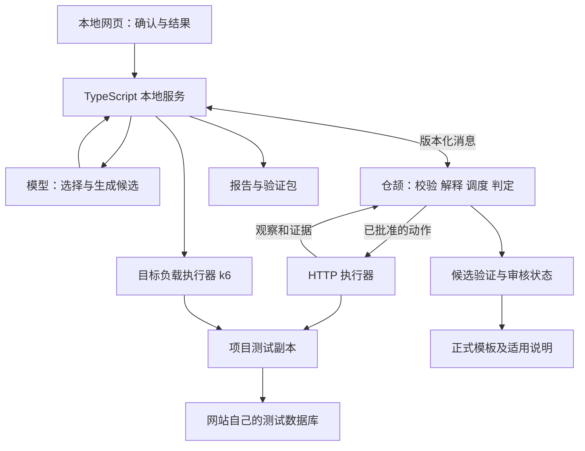

# 网站业务与容量验证系统首版架构与实施计划（最终版）

> 2026-10-17当前入口：代码已至main@ceb8d95，当前操作见[编号流程](../../WORKFLOW_V12.md)，最新检查范围见[提交核验](../../evidence/remote-push-2026-10-17.md)。本文保留T0—T10原任务、日期、成绩及未勾选验收条件；下文旧环境、授权和页面描述是历史快照，不覆盖当前状态。真实人员审核、正式交付与T10仍按各自要求验收。

> 2026-10-14衔接说明：本文件保留既有T0—T10实施历史与开放验收。新增源码业务分析与项目特有检查按[分阶段计划](2026-10-14-code-grounded-business-discovery.md)推进。2026-10-14后续已获D1—D8开发及统一分支同步授权，S1—S5现已开发实现；正式验收延期。本文历史阶段结果不能替代当前分支验收；最新已知问题见[当前会话审查](../../evidence/current-session-review-2026-10-15.md)。下述版本、日期和阶段状态是原计划记录，不作为新能力已完成的证据。

> **For agentic workers:** REQUIRED SUB-SKILL: Use superpowers:executing-plans to implement this plan task-by-task only after the user authorizes coding. Steps use checkbox (`- [ ]`) syntax. 用户已完成T0—T3并后续明确授权T5、T6、T7、T8、T9；本轮用户授权T10并在暂停询问测试项目后要求继续；先准备工单对照项目，真实模型验收及正式人工双审核仍开放，T10正式对照待前置条件关闭；本段记载的原阶段当时未获提交/推送/正式发布授权；2026-10-14后续已授权向 `fix/discovery-analysis-state` 同步开发代码。该授权不包含合并main或正式产品发布。

**Goal:** 在 HTTP/JSON 测试副本上，复用三类种子模板，并让缺模板的业务生成候选实验，经独立验证、审核发布后在第二网站复用；同时完成已确认目标负载的业务与性能验证。

**Architecture:** TypeScript 本地服务负责项目副本、HTTP 会话、模型调用、文件与负载执行；仓颉核心负责声明式实验校验和解释、调度、证据与判定，以及候选准入状态。正式模板和候选分别存储，入库必须关联固定规则、验证证据和审核；网页提供确认、结果及模板适用说明。

**Tech Stack:** 仓颉核心、TypeScript、Node.js 24、React/Vite、k6、JSON/JSONL。被测项目仍采用 Node.js 24、JS/TS、Express 5、SQLite；网站使用独立测试数据库，验证工具只通过 HTTP/JSON 取证。Playwright 仅用于本工具网页的开发验收，不建设被测网站的通用浏览器执行器。

**Spec:** [需求稿 v0.42](../../业务与容量验证系统需求与设计讨论稿.md) R01—R52；[候选模板生成与验证设计](../specs/2026-10-11-candidate-template-lifecycle.md) v1.7；[最新蓝白四页预览](../../../output/ui-preview-final/index.html)。

版本：最终版（2.34，T10对照项目准备与正式运行门槛已更新）。日期：2026-10-13。状态：T0—T3、T5—T8开发验收完成；T4实现和确定性候选验收见[T4记录](../../evidence/candidate.md)，真实DeepSeek及实际双审核正式发布仍开放。T5、T6、T7历史验收分别见[注册库](../../evidence/registry.md)、[工作台](../../evidence/workbench.md)、[受控迁移](../../evidence/transfer.md)。T8已接入真实k6固定目标、低负载门槛、累积状态、停止和在途结算、仓颉判定、网页及报告：全量235/235，最后修订后专项14/14、Edge新增1项及既有5项、最终API6/6通过；完整构建及最终宿主编译通过。独立审查两项Important与浏览器退出问题已修复，见[T8记录](../../evidence/target-load.md)。本机合成数据、带宿主核对开销，不等于线上最大容量；T9已实施普通包/开发者资源分离及本机空配置复现，最终结果见[T9交付检查](../../evidence/release-check.md)，真实模型及实际人工审核仍开放；T10工单两版项目准备已通过HTTP检查，正式同模型对照未运行。原T3证据、T7冻结清单及最新四页预览六源保持。后续修改继续更新本文件，不另留旧版副本。

## 当前源码交互基准（2026-10-14）

原自然流程设计及其已完成实施清单已合并清理；有效的草稿、环境结果、设置返回、审核责任、报告和可访问性约束见[当前流程](../../WORKFLOW_V12.md)及[人工验收标准](../../MAIN_MANUAL_ACCEPTANCE.md)。2026-10-14五步改造的成绩仍以[历史证据](../../evidence/natural-workflow.md)为准，不覆盖当前编号界面或关闭T9/T10正式验收。

## 开工评审与最新预览基准（2026-10-12）

本节保留开工前评审快照；后续用户已授权并完成 T0，当前环境与通过证据以上方状态及 T0 验证记录为准。后续日期安排需按已到达的实际进度重估。

**结论：需求和技术路线足以开始 T0 技术验证，再按阶段推进；不需要继续补齐一轮产品需求。尚不能宣称环境就绪或整套方案已被实测证明。** 本轮用户要求先编写计划，执行仍待后续指令。

| 检查项 | 当前证据与结论 | 开发落点 |
| --- | --- | --- |
| 需求完整性 | R01—R52 已定义用户、范围、例外、凭据、规则、候选准入、复跑及验收；无新增必须由用户决定的范围问题 | 保持任务范围，不新增通用浏览器、多流程或管理后台 |
| 技术栈 | 仓颉核心＋Node.js 24/TypeScript 宿主＋React/Vite；JSON/JSONL 成果；k6 目标负载；Playwright 仅验收工具 UI | T0 固定实际兼容依赖与锁文件，仓颉优先验证 1.0.5 LTS，不擅自改成空转发层 |
| 本机环境 | 实测 Windows 内核 10.0.26100、X64；`D:\Node_js\node.exe` v24.19.0、npm 11.17.0；当前 PATH 未找到 cjc/cjpm/k6 | 不等于全盘未安装；T0 定位并编译仓颉，T8 前实测 k6；未做安装和模型付费调用 |
| 产品代码 | 根目录只有 README、docs、output，无 package.json 或产品源码；根目录未见 .git，Git 状态查询因父路径访问失败 | T0 建立最小工程；版本管理状态另核对，不据此初始化、提交或推送 |
| 最新 UI | `output/ui-preview-final` 当前六个源文件均与 `qa/defect-fixes/source-verification.json` 的 after 哈希一致 | 四页为正式开发基准，旧 v3/v4、修订前 numbered-flow 和旧总览不是当前行为规范 |
| 风险与工期 | 跨语言编译、Windows 凭据存取、真实模型生成、停止/结算及验证包均未实测；原估算 30—40 人工小时对比 27—36 小时容量无可靠返工余量 | T0 与 T4—T5 设置停止检查点；实际启动日变化重新排期；不预先后移 T8 |

界面基准优先级：当前四页 HTML、styles.css 和 preview.js 的视觉与交互意图 → [六项修订与复查](../../../output/ui-preview-final/qa/defect-fixes/修订与复查.md)及同目录截图 → `qa/copy-review` 中未被后续修订覆盖的页面。预览中的账号、版本、延时、报告数值只作示意；R01—R52 和候选准入合同仍决定真实业务语义。

| 页面 | 未来组件 | 职责 |
| --- | --- | --- |
| 项目接入 | ProjectView | 目录、用途、账号、发送范围、测试环境、映射与接入缺口 |
| 业务验证 | VerifyView | 一条流程的规则确认、候选生成/验证、说明预填与双重审核、运行进度、补充条件、目标负载及结算 |
| 验证报告 | ReportView | 业务结果、候选资格与证据查看、历史、导出、修复复跑和模板版本操作 |
| 模型设置 | SettingsView | 地址、用户填写的模型名称、API Key、连接检查、记住与清除 |

维持蓝白、白色卡片、浅色背景、桌面左侧/窄屏顶部导航和按需折叠。2026-10-14按用户确认调整：候选自动验证后，在业务验证页展开参考说明、材料保存与双重审核，发布后继续本轮验证；报告页保留方案和证据查看，运行和负载保持页内状态，不新增阶段页面。顶部“切换项目”“加载验证包”共用既有环境准备及确认组件。

**从预览到真实功能的边界：** 不把 preview.js 复制成生产执行层；其 sessionStorage、固定运行槽位、URL 示例状态和定时跳转不作为判定依据。真实进度由宿主事件与核心状态驱动；没有已保存的运行记录时显示空状态，不能像演示页面一样默认显示 published。API Key 和密码不进入任何浏览器持久存储；切页保留会话不代表结束运行，显式退出/会话结束需清理秘密。

首批按下列交付顺序执行，不先铺满全部界面：

1. **T0：真实跨语言往返。** 中文路径、JSONL、取消及异常退出通过；记录实际 SDK/依赖版本。失败则先修环境，不向后宣称核心完成。
2. **T1：最小可判定实验。** 正常、业务失败和证据不足三种结果可区分，未知不误报通过；禁止任意代码和未注册动作。
3. **T2—T3：工单和独立对照。** 原项目不变、测试库可复位、三类种子走真实 HTTP；固定字段保持规则及独立对照。
4. **T4—T5：真实候选生成到审核发布。** 最多两轮修订；缺可信对照或审核时停止准入，目标网站 fail 不篡改为 pass。
5. **T6—T7：四页接入真实记录与跨项目复用。** 导出真实包、断开模型复跑；冻结模板后仅改映射迁移报名，包含新增性质。
6. **T8—T10：目标负载、交付复现、最后对照。** 停止后结算，随后本机全新目录/空白配置复跑，最后做一业务两组对照；材料窗口继续保留。

用户后续要求开发时，默认从 T0 在当前聊天顺序执行，每阶段依据退出条件继续；仅新的实质范围取舍需要再询问。每个任务先实现能暴露问题的检查，再实现功能，保存真实证据。计划中的命令尚未创建，不能现在作为可运行入口使用。

本轮只读复核：[仓颉官方 1.0.5 下载页](https://cangjie-lang.cn/download/1.0.5)仍列 Windows x64 包；[Vite 官方入门](https://vite.dev/guide/)所列 Node 下限由本机 24.19.0 满足，但不等于项目依赖已集成。DeepSeek JSON 文档本轮读取失败，沿用已确认协议并在 T4 复核，不据此指定模型或宣称实际连接通过。比赛截止时刻与后续公告本轮未重新查证，旧日历只保留为条件估算。

## Global Constraints

- R51：接口变化后复用首次接入的分析、映射确认和试运行；保留原规则、旧映射和历史证据，新映射及运行另存。不建设专项接口差异分析、局部补丁及独立修订界面；重新接入可以依赖 AI，映射未变的有效验证包仍支持无模型复跑。

- R50：一次运行只对应一条用户确认的主流程，可含多个步骤和多项规则检查；计划、进度、报告、验证包及容量验证都绑定该流程。完成后再选下一条，不建立多流程队列、批量执行或跨流程汇总。单流程不等于单请求或单断言。

- R47：首版以 API 配置和少量项目基本信息为入口。预算由有限内部预设管理，不要求用户填写或逐项确认技术参数，不做独立预算页或高级预算面板。将必要确认合并在工作台摘要卡片中；界面简化不削弱证据和候选准入。

- R35 已确认首版仅支持 Windows。T0 核对并记录实际系统版本与架构；T2 进程和路径、T4 系统凭据存储、T6 本地网页启动、T9 本机全新目录与空白配置交付复跑均在本机已记录版本的 Windows 环境验收。按 R52，不另列其他电脑或干净虚拟机验收；其他电脑兼容性标为未验证。Linux/macOS 适配、打包与测试不列入首版，不能以跨平台依赖替代实际兼容验证。

- 首版深度接入限定 HTTP/JSON，采用测试账号密码自动登录并取得 Token 的认证方式（R31）；通用浏览器执行与验证工具直接查库后移。
- 被测网站继续连接独立 SQLite 测试数据库。源码副本与数据隔离不等于操作系统沙箱，不执行任意不可信项目。
- 保留保存结果、重复提交、权限隔离三类种子模板，各覆盖一个明确业务场景；工单和报名各保留一个主流程及必要账号。
- 没有完整模板时可生成受约束声明式候选；缺少底层动作、表达式或可信对照时仍为能力缺口。
- AI 不执行任意 JS/SQL/shell，不修改被测源码，不生成或应用修复补丁，不自行批准候选入库。
- 规则经用户确认；模板需经过静态检查、正反例、受控端到端验证、项目试运行和审核。模型自评不替代独立依据。
- 候选表达范围限于字段关系、数量、有限顺序和布尔组合；不支持复杂定价、任意状态机或新协议的自动扩展。
- R49：适用说明、证据、匹配与停用并入模板；取消独立经验收录、存储和历史影响列表。保留历史报告的版本引用与验证包加载时的资格检查，不主动扫描历史影响。
- 工单开发后冻结模板与判定逻辑，再接入报名验证只改映射的复用；新生成或修改模板的部分另计能力扩展。
- 容量仅验证用户确认的目标负载，保留业务核对、性能阈值、手动停止、资源上限和在途结算；更高负载探索及降载恢复观察后移。
- 模型故障暂停生成与分析；已有规则、映射及条件已确认的正式模板仍可执行。候选未准入不能借故障直接放行。
- 交付网页、Markdown、证据文件与由本工具加载的验证包。首版不输出 PDF 或脱离工具独立运行的脚本。
- 第三个独立已有项目及额外“未见规则”生成评估均为可选补强，不作为首版必做、阶段放行或交付条件，不占用材料预留时间。未做时标为未验证，结论限于已测范围；已选规则的独立正反例、端到端及留出变体仍必做。同模型加工具的两组对照按 R48 放产品验证流程最后。预留 1—2 天整理材料。

## Review Focus

1. 查询缺字段、分页不完整、异步尚未完成：不能因两个缺失值“相等”而通过；T1、T2、T3。
2. 候选恒真、只看状态码、读取评估标签或固定答案：定义与正反例验证要阻止正式发布；T1、T3、T4。
3. 模型故障按 R27 暂停；业务实验写请求发出后崩溃按 R44 保留未完成记录，用户选择恢复后核对条件、隔离旧操作并复位，再从实验第一步重跑，不从未知写请求直接续跑。未准入候选仍被隔离；T2、T4、T6。
4. 候选或规则验证后被修改、验证包被篡改：失效的验证票据不能用于新版本；T5、T6。
5. 压测端受限、人工停止、在途结果未完成：区分网站失败、执行问题和未知，不输出目标已通过；T8。

## 一 当前架构与资产边界

本地服务只绑定回环地址，采用本次启动会话令牌与来源校验。项目目录由用户提供，本地服务解析并确认目标；普通浏览器网页不能直接访问任意本机文件。模型收到经过筛选的摘要或片段，不能读取密钥、真实数据库及评估答案。

| 资产 | 内容 | 修改后的含义 |
| --- | --- | --- |
| RuleContract | 已确认规则、依据、前置条件、期望及完成时限 | 规则变化是新的验收依据，需单独确认 |
| MappingSpec | 登录、创建、更新、查询的 HTTP 路径和字段绑定 | 重新接入后保存新映射版本，确认及试运行后复测；保留旧版本，不改变业务判定规则 |
| TemplateSpec | 参数化步骤、断言、证据要求、能力依赖与预算 | 内容改变生成新候选版本，重新验证 |
| ValidationRecord | 验证范围、规则、候选、解释器、对照集、执行环境的映射摘要与验证结果 | 相关摘要变化使该范围内记录不能证明新版本；新项目映射变化不自动撤销原模板的通用资格 |
| TemplateMetadata（模板内嵌） | 适用与排除条件、使用说明、验证证据、匹配依据 | 随模板版本及准入管理，无独立经验收录状态 |

仓颉执行与解释模板，不能只为 TypeScript 的最终判断做转发。校验“能否执行”“是否证据充分”“能否入库”的状态转换必须在核心中发生；宿主实际执行动作并保存证据。

### 实现精简约束（2026-10-12 已确认）

以下是现有任务的共用机制，不新增功能阶段、通用插件框架或独立服务，也不提前创建未来模块。

| 共用范围 | 最小实现与任务落点 | 必须保留的区别 |
| --- | --- | --- |
| 首次接入、修复后复测、中断重跑 | T2 建立一条环境核对、数据基线恢复和运行准备流程，T6 复测及重跑入口调用同一流程 | 中断重跑先隔离旧操作，新 attempt 关联旧记录；数据复位失败阻止依赖实验。容量仅运行前准备，运行中不逐请求复位 |
| 候选验证、正式运行、验证包复跑 | T1 解释器、T2 HTTP 执行器、T3 取证机制共用，T4/T6 按运行范围调用 | 候选仅在对应受控阶段获准执行；正式运行及复跑核对发布版本和资格。观察样本不能替代真实 HTTP 端到端记录 |
| 网页结果、Markdown 报告、验证包 | T6 从同一份版本化运行记录派生视图和导出，不分别维护业务判定 | 验证包保留复跑所需规则、模板、映射、前置条件及引用证据；不同导出各自过滤秘密，不能只导出一张结果表 |
| 模板跨项目使用 | T5 保留固定版本的通用资格，T2/T7 对新项目确认映射并试运行 | 模板及其规则/解释器/对照依据未变且资格有效时，换项目映射不重走整个发布流程；新项目不能继承旧项目的通过结论 |

T3—T7 先贯通至少一个新性质候选的生成、独立检错、审核发布和第二网站仅改映射复用，再依据真实阻塞与耗时重估后续安排。沿用阶段门槛，不降低三类种子、目标负载、凭据存储、独立验证或材料要求，不宣称上述合并已节省固定工时。

## 二 数据合同与候选准入

### 共享结构

T0 建立 JSONL 消息框架，T1 固定 schema v1。每条消息包含 schemaVersion、messageId、runId、kind、payload；观察绑定 actionId。stdout 只输出协议，stderr 记录日志。超时、退出、取消必须有终态。

| 类型 | 必备字段 |
| --- | --- |
| RuleContract | id、version、confirmation、source、preconditions、expectedChanges、invariants、completionDeadline |
| MappingSpec | id、version、authMode、operations、actorRefs、targetRef、resultBindings、queryCompleteness；不包含密钥值 |
| TemplateSpec | id、revision、ruleRef、parameters、requiredCapabilities、steps、assertions、evidenceRequirements、limits |
| ToolAction | actionId、operationId、actorRef、intentId、attemptId、bindings、deadline |
| Observation | actionId、transportStatus、identityVerified、acceptance、result、queryComplete、evidenceRefs |
| Verdict | pass/fail/inconclusive、reasonCode、ruleRef、assertionRef、evidenceRefs、scope |
| ValidationRecord | scope（模板验证或项目试运行）、candidateHash、ruleHash、interpreterVersion、suiteHash、mappingHash（该记录执行环境的映射）、gateResults、evidenceRefs；项目范围另绑定 projectId |
| ReviewRecord | validationRef、businessConfirmation、technicalReviewer、decision、time、scope |
| TargetLoadPlan | flowRef、targetRate、duration、operationMix、dataScale、latencyThreshold、errorThreshold、window、maxOperations、settlementDeadline |

主要消息为 start、action、observation、cancel、event。start 区分正式运行与候选验证/试运行：正式运行只接受已发布版本；受控候选运行必须有对应阶段的校验记录与用户已确认的测试范围。

实验运行状态为 draft、awaiting_confirmation、ready、running、paused、blocked、completed、cancelled；completed 不是业务全部通过。候选状态单独为 draft、needs_rule、needs_capability、validating、rejected、ready_for_review、published、disabled。

### 受约束实验定义

步骤仅能调用 MappingSpec 声明的 operationId；每步有唯一 stepId、actorRef、参数绑定和输出变量。首版无递归、动态代码或无界循环；重复操作展开为有限步骤。

表达式使用字段读取、常量、exists、eq、neq、count、contains、all、any、not。字段路径由受限字段段组成，不支持执行表达式。比较只接受兼容类型；缺值与 JSON null 分开处理。任何关键证据未知时，该断言不能通过；存在已证实违规时可报告该违规，同时保留其他未知项。

静态检查能拒绝未定义变量、常量与常量的无意义断言、未注册操作、无上限重复及明显恒真条件，但不能证明任意业务断言正确。测试结果与审核仍是必要门槛。模板输入不含评估标签、缺陷开关或答案目录引用。

### 准入合同

1. 规则已确认且冻结，动作、表达式和证据要求在能力范围内。
2. 定义通过类型、依赖和预算检查。
3. 正常观察应 pass；对应错误应命中预期 assertionRef；证据不足应 inconclusive。
4. 独立受控 HTTP 正常行为通过，对应缺陷因业务断言失败；崩溃/超时不计作检错成功。
5. 项目副本试运行完成映射、身份和证据关联检验，可复跑。目标项目存在真实业务 fail 不自动阻止模板入库。
6. 保存业务确认与开发者技术审核，验证记录与当前内容摘要一致，才发布固定版本。

模板验证记录与项目试运行记录沿用同一结构，以 scope 区分并关联。首次发布需对应的模板验证和目标副本试运行记录；后续迁移只要通用资格仍有效且相关模板、规则依据、解释器与对照依据未变，就复用模板资格，另存新项目映射及试运行记录，不因 mappingHash 不同重复整个发布流程。任一记录只能证明其绑定范围与版本；模板或通用验证依据变化时仍重新验证，停用版本仍禁止直接执行，新项目的业务要求仍须单独确认。

缺少可信参考行为或技术审核时允许保留草稿，不能用第二次模型自评替代。模型可以修订候选，但不能修改冻结规则、验证标签或准入门槛；修订消耗预算；R34 已确认首次生成后最多自动修订 2 轮，通过即停止，仍失败则保留草稿与各轮记录，不发布、不自动重开任务绕过上限。缺原语或可信对照直接报告缺口，其他预算耗尽可提前停止。目标项目自身出现有证据的业务失败不等于候选验证失败，不能为了让项目通过而修订断言。

## 三 拟创建文件与阶段

工作根目录：`C:\Users\xie\Desktop\Project`。以下为未来实施路径，本轮只修改文档。

| 路径 | 职责 |
| --- | --- |
| `apps/core/src/{protocol,contracts,interpreter,scheduler,verdict,budget}.cj` | 仓颉消息、声明式实验及判定 |
| `apps/core/src/{admission,registry,load}.cj` | 候选准入、版本资格、模板匹配与目标负载状态 |
| `apps/host/src/projects/{inspect,copy,start,reset}.ts` | 项目副本及启动复位 |
| `apps/host/src/execution/{http,mapping,session}.ts` | HTTP/JSON 注册操作与会话 |
| `apps/host/src/model/{provider,context,proposal,candidate}.ts` | 模型适配与候选生成 |
| `apps/host/src/validation/{observations,reference-runner,review}.ts` | 正反例、参考服务运行与审核输入 |
| `apps/host/src/artifacts/{store,manifest,report,replay}.ts` | 证据、包、报告与复测 |
| `apps/host/src/templates/store.ts` | 草稿与正式模板版本存储，内含适用说明及证据 |
| `apps/host/src/load/{runner,ledger,metrics}.ts` | k6 执行、操作账本和测量 |
| `apps/ui/src/{App,ProjectView,VerifyView,ReportView,SettingsView}.tsx` | 最新蓝白四页；规则、候选生成/验证/审核、运行为业务验证页内状态；报告页保留候选与证据查看及目标负载 |
| `packages/contracts/`、`templates/` | 共享 schema、类型、契约样本、三类种子模板 |
| `tests/reference/`、`tests/fixtures/` | 开发者审核的 HTTP 参考服务与固定观察对照 |
| `samples/ticket/`、`samples/registration/` | 两个小型网站，报名于冻结后进入迁移评估 |
| `scripts/`、`tests/{contracts,integration,e2e}/` | 构建、检查、测试与交付命令 |
| `.local-data/` | 副本、凭据引用、运行成果、候选与模板；不随源码或公开包导出 |

候选目录与正式目录分离。证据按 projectId/runId 保存配置快照、events.jsonl、文件及哈希；验证集与秘密不进入模型上下文或候选包。密钥通过本机 secretRef 重新绑定。

| 阶段 | 核心交付 | 阻止进入下一阶段的条件 |
| --- | --- | --- |
| T0—T1 | 跨语言协议与声明式解释器 | 消息或未知证据被误判，任意代码可执行 |
| T2—T3 | HTTP 接入、独立参考环境、三类种子检查 | 无可靠取证，正反例无法区分 |
| T4—T5 | 无模板时生成、验证、审核、发布 | 只有草稿或模型自评，没有真实检错与准入证据 |
| T6—T7 | 网页、验证包、模板说明及报名迁移 | 断模型不能复跑，迁移实际修改模板却未记录 |
| T8 | 已确认目标负载验证 | 无停止通路或在途结算，未知被报告通过 |
| T9 | 本机交付复跑与材料基础 | 全新目录及空白配置不能复现，包泄露凭据或缺证据；不得宣称其他电脑已兼容 |
| T10 | 一次小型同模型两组对照 | 一个代表性业务，放在最后，不建设完整评测体系 |

## 四 逐任务实施计划

命令均为未来创建的入口，不代表已经存在或执行。T0 注册 `npm run check`（类型检查与构建）、`npm run verify -- <group>`（调用 scripts/verify.mjs）、`npm run package`。测试涉及核心时必须启动实际编译的仓颉进程。先写能暴露目标缺陷的测试，确认失败后实现，再验证通过；不为文档或简单界面文案建立重复实现的测试。提交和发布不在默认步骤中。

### T0 环境与协议

**文件：** 新建 package.json、scripts/doctor.mjs、scripts/build-core.mjs、scripts/verify.mjs、apps/core/cjpm.toml、apps/core/src/protocol.cj、apps/core/src/main.cj、apps/host/src/core/client.ts、tests/contracts/protocol.test.mjs。

**接口：** `CoreClient.send(message: Envelope): Promise<CoreEvent[]>`；Envelope 是本计划第二节的消息对象，CoreEvent 是 kind=event 的消息。进程由明确可执行路径与 argv 启动。

- [x] 核对 Node、仓颉 SDK、k6 与本工具 UI 测试浏览器的实际路径版本；安装只在实施获准后按实际权限处理。
- [x] 以 npm workspaces 管理 host/ui/contracts；T0 仅创建通信所需最小工程，UI 在 T6 创建。用精确依赖与 package-lock.json 固定成功组合，编译宿主 TypeScript 后运行；核心通过 cjc/cjpm 的实测命令构建，JSON 库以实际可编译结果选定并锁定。环境记录区分“可找到”“可运行”“已集成”，k6 与 Playwright 分别在 T8/T6 前完成实际检查。
- [x] 写 `protocol_utf8_roundtrip`、`reject_version`、`cancel_and_exit`：中文与空格路径往返无损、未知版本拒绝、退出不永久等待、stdout 混日志视为协议错误。
- [x] 实现消息回路、错误码与编译包装，锁定实际可用构建命令。
- [x] 运行 `npm run verify -- protocol`；成功须包含真实仓颉进程证据。
- [x] 在 docs/evidence/environment.md 记录版本及问题；若仓颉不可用先解决，不将其职责移空。

### T1 声明式语言与核心合同

**文件：** 新建 packages/contracts/schema.json、types.ts、fixtures/；apps/core/src/contracts.cj、interpreter.cj、scheduler.cj、verdict.cj、budget.cj；tests/contracts/interpreter.test.mjs。

**接口：** `validateTemplate(spec: TemplateSpec, capabilities: CapabilitySet): ValidationResult`；`advance(state: RunState, observation: Observation): Transition`。CapabilitySet 为已注册操作及支持表达式；ValidationResult 含 valid 和问题列表；Transition 含下一状态、动作与判定。

- [x] 按第二节固定类型与缺值语义；测试 `missing_is_not_equal`：两个缺字段仍是 inconclusive；`mismatched_type` 不隐式转换。
- [x] 测试 `reject_unknown_operation`、`reject_unbounded_repeat`、`reject_answer_access`：未注册动作、无界重复、标签字段与答案文件访问均拒绝。
- [x] 实现单主流程内的解释与调度，测试 `independent_check_continues`、`unknown_action_rejected`、`cancel_stops_dispatch`；某检查受阻不妨碍同一主流程内条件完备的其他独立检查。保证检查间数据隔离、消息去重，人工取消停止派发；不建立多流程调度或队列。
- [x] 把三个种子模板也表示为同一语言，不为生成模板另造一套不受检查的解释器。
- [x] 运行 `npm run verify -- interpreter`；共享样本经 TS 校验与核心执行语义一致。

### T2 HTTP 项目接入与独立数据库

**文件：** 新建 samples/ticket/package.json、src/server.ts、src/db.ts；apps/host/src/projects/ 下四个模块；execution/http.ts、mapping.ts、session.ts；tests/integration/access.test.mjs。

**接口：** `inspectProject(root: string): Promise<ProjectProfile>`；`prepareCopy(profile: ProjectProfile, config: TestConfig): Promise<TestEnvironment>`；`execute(action: ToolAction, context: RunContext): Promise<Observation>`。Profile 列启动方式、支持能力和缺口；TestConfig 显式给端口、初始化与测试账号；Context 绑定测试目标、会话和预算。

- [x] 创建工单样例的登录、创建、查询与更新接口，两个普通用户；数据库为独立测试数据，更新用于候选模板演示。
- [x] 按 R41 仅准备专用测试数据：识别已有测试初始化脚本或支持的创建接口，展示作用目标、测试账号、数据规模与初始状态，用户确认后在独立副本执行。复制源码时排除原业务数据库及其备份，独立测试库由已确认流程创建；不实现真实库或脱敏库导入。缺初始化条件按 R42 生成具体补充说明；首版不生成初始化脚本、不修改被测源码、不执行临时生成的初始化代码。
- [x] 按 R42 保存初始化缺口说明，包括所需账号角色、数据与归属、初始状态、初始化及复位要求、受影响实验和验收条件；T6 支持查看、复制并随 Markdown 报告交付，不调用外部编码 AI 或自动代用户发送。说明只使用必要的脱敏信息，不含密码、密钥或真实业务数据。用户补齐后重新核对入口、目标及数据再恢复依赖检查；不改已确认业务规则。
- [x] 验证缺口状态不会被报告成通过或业务失败、无初始化条件时不执行依赖实验、独立实验不被无故阻塞、补齐说明本身不算完成、未通过重新接入检查不能恢复相关运行。
- [x] 验证初始化目标明确绑定测试副本、数据来源可追溯、初始化失败不进入依赖检查、复跑可回到声明的初始条件；若原项目测试脚本硬编码原库或外部服务，暂停并要求调整，不能仅因名称含 test/seed 就认定可执行。记录初始化版本、数据生成参数及规模；可复查记录不包含测试密码。
- [x] 实现账号密码 HTTP 自动登录与 Token 认证，按 actorRef 隔离各测试账号；模型只提议登录接口、字段与请求绑定，不能接触凭据实际值。不承诺 Cookie、SSO 等其他认证自动兼容。
- [x] Token 仅存本次运行内存，结束或退出后不持久化；从模型输入、日志、报告及验证包中过滤登录响应和认证头中的秘密值。复跑重新登录。验证账号身份不串用、导出无凭据及运行结束清理；模型密钥按 R33 可选存入操作系统凭据存储，与网站会话分开管理。
- [x] 按 R32 保存项目对应测试账号名，密码仅保存在本次工具会话内存；关闭工具后清除。连续运行可用内存密码重新登录，重新打开工具必须补充密码。验证密码不写入配置、日志、报告、验证包和模型请求；会话终止与前后端退出的清理机制在实施时验证，不将关闭网页标签直接等同于后台已退出。
- [x] 写 `original_unchanged`、`path_escape_rejected`、`port_conflict`；实现副本、显式 argv 启动，并按 R43 在每个独立普通业务实验前恢复已确认基线，不能只在一整轮结束后复位；按 R41 创建独立测试库，不从原业务库复制数据，原库保持不变。
- [x] 写 `login_200_is_not_identity`、`incomplete_page`、`old_record_excluded`、`external_service_blocked`；以身份检查、业务标识和分页完整性验证 HTTP 取证。
- [x] 实现 R43 的实验准备阶段：先保存前次实验事件与证据、停止并隔离仍可能写入同一测试库的前次操作，再按已确认初始化方式恢复数据并检查基线；未确认复位完成时不得启动依赖实验。一个共享测试库上的独立实验顺序执行，避免某实验复位影响另一实验。
- [x] 验证前实验创建的记录不会污染后实验、重复提交的两次操作之间不复位、相同初始条件可复跑、复位失败标环境受阻、历史证据不被复位覆盖。容量任务不复用逐实验/逐请求复位逻辑，运行中保留累积状态；对应边界在 T8 验收。
- [x] 实现 R44 的中断重跑：将原 attempt 标为未完成并保留证据；用户选择恢复后核对代码、规则、映射、数据基线、环境及预算，确认旧进程或异步操作不再写入测试库，再复位并创建新 attemptId，关联原记录，从第一步执行。条件变化须展示并重新满足对应确认门槛，不能声称原条件下续跑。
- [x] 验证写请求已发出但无响应时不盲重试、复位失败保持阻塞、旧证据不被新成功覆盖、新尝试从首步开始、其他已完成独立实验记录保留。候选任务重跑不重置 R34 修订计数；模型分析暂停按 R27，容量不实现中途续跑。T6 提供明确“恢复初始数据并重跑该实验”操作。
- [x] 将上述环境核对、旧操作隔离、基线复位、身份和证据关联检查组织为共用准备流程，供首次接入、T4 目标试运行及 T6 复测/中断重跑调用；复用现有检查，保留不同入口的确认及新 attempt 要求。容量只在运行前复用准备，不在运行中逐请求复位。
- [x] 运行 `npm run verify -- access`，保留源目录及原数据库未变证据。

不新增通用浏览器执行器、抓取录制器或 SQLite 直读取证器。用户可指出查询页面作为定位线索，但正式取证必须落到支持的 HTTP 接口；只有页面而无可支持查询时报告能力缺口。网站仍使用自己的数据库。首版副本不构成恶意代码沙箱，外部访问须按配置核对，不能宣称已实现全面网络隔离。

### T3 独立验证环境与种子模板

**文件：** 新建 tests/reference/server.ts、behaviors.ts、suite-manifest.json；tests/fixtures/observations.json；templates/saved-result.json、duplicate-submit.json、permission-isolation.json；apps/host/src/validation/observations.ts、reference-runner.ts；tests/integration/validation-harness.test.mjs。

**接口：** `validateAgainstSuite(candidate: TemplateSpec, suite: ValidationSuite): Promise<ValidationRecord>`。Suite 指向经审核的规则依据、观察样本、参考行为、预期 assertionRef 和非公开对照版本；模型和候选不能读取标签。

- [x] 为三类种子各准备一个正常、一个业务缺陷和证据不足场景；另备标题更新的正常、优先级重置、所有者改变对照。
- [x] 开发者核对规则来源、预期结果和参考服务，固定版本；该 HTTP 服务是专用验证设施，不冒充真实外部依赖的模拟接入。
- [x] 写 `always_pass_rejected`、`always_fail_rejected`、`status_only_rejected`、`crash_is_not_detection`：正确对照须通过，错误须命中对应断言，崩溃或超时只能表示验证未完成。
- [x] 实现观察验证及整链 HTTP 执行，身份、对象关联、最终查询均走 T2 执行器。
- [x] 运行 `npm run verify -- validation-harness`。只测假观察数据不能代替端到端验收；缺可信对照的规则保持未支持。

执行证据：[T3验收与接口](../../evidence/validation-harness.md)、[固定场景结果](../../evidence/t3-result.json)、[独立审查及修复](../../evidence/archive/t3-review.md)。标题更新为验证设施测试候选，真实模型生成和审核发布仍在T4/T5；套件技术检查通过不等于发布。

### T4 模型接入 候选生成与分层验证

**文件：** 新建 apps/host/src/model/provider.ts、context.ts、proposal.ts、candidate.ts；apps/core/src/admission.cj；tests/integration/candidate.test.mjs。

**接口：** `propose(context: FilteredContext, catalog: TemplateCatalog): Promise<Proposal>`；`generateCandidate(rule: RuleContract, capabilities: CapabilitySet, budget: GenerationBudget): Promise<TemplateSpec>`；`advanceAdmission(candidate: CandidateState, record: ValidationRecord): CandidateState`。Proposal 含一条推荐主流程、该流程的待确认规则、映射提议与匹配理由；用户可改选，但 ConfirmedPlan 只接受一条流程；GenerationBudget 限调用次数、步骤、执行时间和修订轮数。首版 maxAutoRevisions 固定上限 2，revisionIndex 为 0（初次）、1、2；一次修订不等同于一次模型调用，调用预算独立计数。

- [x] 按 R40 在首次发送项目内容前由 T6 展示拟发送文件范围、内容类型及模型服务地址，保存 projectId、范围、接收地址和确认记录。T4 在每次请求前校验范围与当前接收地址，并过滤敏感内容；扩展范围、变更服务地址时暂停相关发送并请求确认，其他无需扩展的工作可继续。范围识别与过滤先在本地进行，不能为了生成确认页先上传未获确认的源码。
- [x] 验证首次未确认不发送、范围内连续请求不反复弹窗、越界文件与改变服务地址重新确认、跨项目记录不能复用，以及范围内仍排除密码等秘密。路径规范化后做范围匹配，实际发送清单记录文件标识及内容类型，日志不存敏感原文；不把文件范围批准当成全量上传授权。
- [x] 按 R36/R38 实现 Chat Completions＋JSON 输出适配器，开放接口地址、模型名称和 API Key 配置，由 T6 展示配置与连接检查。首个实际验证服务已按 R37 确定为 DeepSeek 官方 API；协议已由 R38 固定，模型按 R39 由用户填写，不设默认值；不增加多供应商原生适配。用不含项目秘密的最小请求检查认证、实际响应及所需结构化输出，区分连接成功与完整候选能力验收。
- [x] 实现 R39：模型配置初始不预填默认名称，缺失时提示补充；无效或不兼容时说明原因，不静默换模型。运行记录保存实际请求模型与非敏感调用配置；T6 配置界面与 T10 同模型对照沿用。验证未配置不调用、填写值原样用于请求、不自动回退模型。
- [x] 按官方接口使用 `/chat/completions` 与 `response_format: {type: "json_object"}`；提示明确要求 JSON，并限制输出预算。模型返回内容先解析再做 schema 与语义检查；空内容、截断、格式错误、字段类型不符均不得进入执行器。生成修订计入 R34，接口故障按 R27 暂停，不能通过解析重试绕过预算。
- [x] 验证无效地址、认证失败、模型不存在、响应结构不兼容和结构化输出不符合约束时有清晰状态，不将 HTTP 200 当作兼容通过。模型生成仍仅使用筛选后的摘要，不包含密钥、数据库及评估答案；模型密钥只交给已配置的模型连接，不能混入项目登录请求。
- [x] 实现 R34：候选验证失败才在剩余预算内修订，记录版本、轮次、允许公开的诊断与验证结果；检查初次通过不修订、第二轮后仍失败不再生成、能力缺口不修订、资源预算提前停止、项目业务缺陷不触发放宽断言。保存或恢复任务不能重置修订计数；模型服务故障按 R27 暂停，不自动变成新任务。
- [x] 实现 R33 的模型凭据存取边界（本轮精简复核已明确保留，不后移）：仅用户主动勾选后写操作系统凭据存储；配置只存引用，未勾选只留会话内存。提供清除操作；已保存凭据清除时同步清除会话缓存，后续 AI 调用需重新提供。存储不可用时提示，不能退回明文文件或浏览器 localStorage。T6 配置页接入这些操作，T9 检查成果和日志无密钥；验证关闭重开、清除、读取失败与不记住路径。
- [x] 固定“只改标题，优先级和所有者不变”的规则，生成器不能取得完整目标模板，只得到规则、可用原语和格式说明。
- [x] 生成候选并运行 T1 静态检查、T3 观察及端到端验证、T2 目标副本试运行；目标存在真实 fail 不自动否定候选。
- [x] 测试 `generation_is_not_publication`、`rule_cannot_be_weakened`、`unknown_capability_waits`、`budget_exhausted`、`provider_down_pauses_candidate`，失败保留证据与草稿。
- [ ] 运行 `npm run verify -- candidate`，并记录一次真实模型生成后通过分层验证的候选；模拟模型故障测试与真实调用证据分别保存。

**第一关键门槛：** 真实生成、正常通过、对应错误检出、证据不足为未知必须同时出现。若只生成了 JSON 或模型自称通过，不继续把该能力包装成已完成。

执行证据：[T4实现、自动验收与真实入口](../../evidence/candidate.md)、[独立审查修复](../../evidence/archive/t4-review.md)。以上实现子项使用确定性模型输出实际执行仓颉/观察/HTTP/目标副本验证；不是AI生成成果。最后一项保留未勾选，须获得真实DeepSeek候选的完整证据后才能完成T4。T6正式确认页尚未开发，本轮由本机安全入口展示范围并取得确认。

### T5 模板审核发布 匹配与停用

**文件：** 新建 apps/core/src/registry.cj；apps/host/src/templates/store.ts、validation/review.ts；tests/integration/registry.test.mjs。

**实际接口：** `TemplateRegistry.stageCandidate(taskId, metadata)`；`publishCandidate(candidateHash, record, review): Promise<PublishedTemplate>`；`matchTemplates(capabilities, rules): Promise<Match[]>`；`disableVersion(ref, reason): Promise<void>`；`assertQualified(ref)`与`matchReport`。注册库自行重读已发布版本及停用记录，不接受可能过期的调用方模板数组；异步接口对应磁盘与仓颉调用。详见[T5接口与证据](../../evidence/registry.md)。

- [x] 实现草稿隔离、验证摘要绑定、业务确认与开发者技术审核，只有 core 准入通过才能发布固定版本。
- [x] 测试 `changed_candidate_needs_revalidation`、`changed_rule_invalidates_ticket`、`missing_review_blocks`：验证后改内容或缺审核不能发布。
- [x] 将适用与排除条件、使用说明及验证证据内嵌模板，沿用模板准入审核；新项目统一匹配已发布且未停用的模板并返回展示依据。取消独立经验文件、收录状态、确认入口及历史影响列表；不同网站同名不等于规则相同。正式展示接线属于T6。
- [x] 验证规则不符不匹配、停用模板不推荐、历史模板和证据不改写，提供精确版本资格检查。T6加载验证包及历史报告接线仍待T6验收；已停用不得直接执行，选择有效替代版须重新确认复测。不建立反向历史列表、主动通知或自动复测。
- [x] 运行 `npm run verify -- registry`（修复后18/18）；补充缺失/损坏及故障透传后20项随最终全量193/193通过。可复用规则、新入库版本、未解决规则分别统计；匹配资格不冒充已经执行跨项目复用，真实复用统计留给T6/T7运行记录。

**T5开发验收已完成，T4—T5真实闭环未完成：** 本轮只有隔离测试目录的确定性候选和测试审核身份，未把它们写入正式模板库。真实DeepSeek候选、真实业务确认与开发者技术审核后的正式发布仍开放。审查及RED→GREEN见[t5-review](../../evidence/archive/t5-review.md)。

### T6 最小网页 报告与无模型复跑

**文件：** 新建 apps/host/src/api.ts、artifacts/store.ts、manifest.ts、report.ts、replay.ts；apps/ui/src/App.tsx、ProjectView.tsx、VerifyView.tsx、ReportView.tsx、SettingsView.tsx、components/PreparationCard.tsx、api/client.ts、styles.css；tests/integration/replay.test.mjs、tests/e2e/workbench.spec.ts。output/ui-preview-final 作为只读参照保留。

**接口：** `confirmPlan(proposal: Proposal, decisions: UserDecisions): ConfirmedPlan`；`exportPackage(runId: string): Promise<PackageManifest>`；`loadReplay(manifest: PackageManifest, environment: TestEnvironment, secrets: SecretBindings): ReplayPlan`；`renderReport(result: RunResult): string`。

- [x] 按最新预览实现项目接入、业务验证、验证报告、模型设置四页，App 管理导航和 projectId/runId，宿主提供真实状态；模型配置归 SettingsView，目录、用途及账号归 ProjectView。DeepSeek 官方地址预填，模型名不预填，保留可选记住密钥。无运行时报告显示空状态，不从 URL 参数或演示默认值伪造通过/发布。
- [x] 按 R50 将计划、运行及导出绑定一条主流程，界面只显示该流程进度和各项检查结果；结束后提供选择下一条流程的入口，沿用未变化的有效配置和映射，保留旧运行记录。不建设多流程调度及汇总。验证多流程计划被拒绝、单流程多规则检查可执行、下一轮不覆盖旧证据；规则检查仍可使用多个账号和必要操作步骤。
- [x] 将首次发送范围、启动及测试数据摘要与关键业务疑问合并成必要确认卡片；已有明确确认不重复弹窗。规则/计划卡内嵌 VerifyView，不创建独立计划配置页。PreparationCard 共用于普通复跑、包复跑及中断重跑，保留各自条件核对、关联新运行和复位要求。
- [x] 系统采用有限的内部预算预设，不新增预算表单或高级面板。T4 在开发时确定并验证调用次数、累计 Token、单次输出、步骤数及超时上限，启动时校验预设存在且有限；缺失/非法时报告配置错误。预算耗尽保留进度并说明原因，不自动提高上限或重置 R34 计数。实际使用量和预设版本记入证据，可折叠查看。
- [x] 运行只突出阶段、停止按钮和必要补充；结果首先展示问题、证据、无法验证及下一步。保留复制说明、导出验证包、复测按钮，技术详情折叠；候选技术审核与模板适用说明仍在同页卡片，不另设经验确认，不建设独立模板或经验后台、复杂实时图表。
- [x] 验收基本信息路径无需填写预算即可开始分析，规则不明不被默认确认，范围扩展仍被拦截，预算达到上限会暂停，未审核候选不能因界面合并而发布；容量入口按需展示目标业务信息，不要求手写执行参数。
- [x] 保存一份版本化运行记录，包含规则和映射版本、动作、判定、证据及哈希；网页结果、Markdown 报告和验证包从该记录派生，不另存各自可变的业务判定。报告包括预期/实际、失败与未知、候选资格和未覆盖范围；验证包包含复跑合同、前置条件和引用证据，所有视图及导出均不带密钥或答案。
- [x] 测试 `replay_without_model`、`reset_makes_runs_comparable`、`package_tamper_rejected`、`version_mismatch`、`escape_rejected`。
- [x] 按 R51 提供“重新接入该流程”操作，复用 T2/T4 的首次接入分析和映射确认，不新增接口差异分析或局部补丁模块。沿用基本配置，保留原业务规则及模板，新映射试运行成功后创建新运行；旧映射、验证包、报告和证据保持原样。规则改变单独确认，写请求完成情况未知时不自动重发。
- [x] 验证重新接入后规则版本保持、旧记录未被覆盖、无效映射不能执行；映射未变的验证包仍可无模型复跑，重新分析依赖 AI 时按 R27 暂停及恢复。查询超时或取证失败先记接入/证据不足，不自动推断接口变化。复用首次接入的已有检查，不新增专项差异修订测试。
- [x] 运行 `npm run verify -- replay` 与 `npm run verify -- workbench`。Playwright 只检验本工具界面，不能因此宣称支持被测网站浏览器自动化。

**最新预览行为的正式验收：** 下列断言在 T6 的 workbench/replay 中检查；涉及 T5/T7/T8 的最终端到端结果，在相应任务集成后补齐，不能用模拟服务结果标记正式能力完成。

- [x] `progress_uses_real_events`：默认入口无需 inspect 控件；连接、复跑及结算只在真实终态后推进。延迟响应期间保持进行中；后端失败不能被定时器变成成功。报告切页、刷新始终保持当前 projectId/runId 和旧证据。
- [x] `scope_edit_preserves_form`：扩大范围只撤销发送同意；目录、用途、账号、会话密码及不受影响的环境确认保留；发请求前仍由宿主阻断未确认范围。域名变化使相应确认失效，跨项目不得复用同意。
- [x] `qualification_is_version_scoped`：停用 v1.0 阻止其包复跑和新项目运行，不污染有效 v1.1；替代版必须重新确认，摘要、资格详情与实际执行版本一致。T5 registry 与 T7 transfer 同步验证。
- [x] `load_is_bound_to_selected_checks`：来源运行、主流程、所选规则与操作账本一致；存在已确认失败/无法验证时阻止容量入口，全部待定也阻止。T8 target-load 验证真实派发和结算，未知不冒充达标。
- [x] `pending_rules_are_observations`：已授权范围内的待定项只保存观察，与已确认检查并列；没有对错结论，不执行未经授权的额外动作。全部待定的观察成果可导出，但不能作为验证包直接验证复跑；用户确认规则后另建计划和运行。
- [x] `evidence_and_package_keep_business_scope`：三类种子各有本轮请求、对象及断言证据；包导出后真实读回并核对哈希、项目、映射、所选规则和原始运行。T7 报名包复跑必须指向报名测试基线，新运行关联来源，不能借用工单证据。
- [x] 将首轮 UI 按 1280/768/390 宽度检查四页及规则、候选审核、失败/未知报告、包复跑、目标结算状态；保存本轮截图，比较最新基准。键盘导航、焦点/表单标签和状态播报做必要检查。预览 QA 的历史通过数不能移作产品测试结果。

**T6开发验收范围：** 四页接线、单流程多规则、真实记录/导出/包复跑、重新接入保留规则及历史、范围/预算/版本/中断边界已验收。上文引用的T7报名证据、T8真实负载派发/结算仍未验证，不因T6界面检查勾选其任务。T4真实DeepSeek及实际双审核正式发布仍开放。证据、启动命令、截图及独立审查见[T6记录](../../evidence/workbench.md)。

### T7 冻结后在报名网站复用

**开发验收边界：** 下列勾选指隔离测试发布版本和开发验收身份的受控迁移；不是T4真实模型或实际人工双审核正式发布闭环。报名参与了接入调试，通用records基线协议在本阶段补强；模板/规则/解释器/验证集未变。详情见[迁移证据](../../evidence/transfer.md)。

**文件：** 新建 samples/registration/package.json、src/server.ts、src/db.ts；tests/integration/transfer.test.mjs；docs/evidence/transfer.md。

**接口：** 复用已冻结 PublishedTemplate、判定逻辑和核心版本；MappingSpec 按报名项目建立并确认，记录新的项目试运行，模板通用资格有效时不重复整个发布流程。报名是主流程加必要测试用户，不包含支付、限额争抢。

- [x] 冻结三类种子及 T4—T5 形成的新模板，记录模板、解释器、验证集版本；冻结发生在报名适配之前。
- [x] 用不同接口和字段接入报名，确认报名记录编辑时对应字段保持要求，再调整登录、创建、更新、查询映射。
- [x] 运行 `npm run verify -- transfer`，验证三类种子和新增模板；不向工具提供预设缺陷答案，源码与正常业务规则仍可读。
- [x] 核对模板和判定摘要未变，记录人工帮助、失败、未知和文件变更；保留有效模板资格并保存报名项目的新映射及试运行证据，核对未重复发布模板、未继承工单项目的通过结论。若必须修改模板，重新验证并记为能力扩展，不能继续当作原模板直接复用成绩。
- [x] 保留一个规则不同的反例，验证系统能拒绝误套。两个自建样例只证明受控条件，第三方项目可选。

评估分开报告“候选成功生成并验证”和“生成后的固定模板迁移成功”。若第二项目也用于修订，不能继续称它为未参与调试的迁移样例。

### T8 目标负载验证

**文件：** 新建 apps/host/src/load/runner.ts、ledger.ts、metrics.ts；apps/core/src/load.cj；templates/load-http.js；tests/integration/target-load.test.mjs。

**接口：** `startTargetLoad(plan: TargetLoadPlan, mapping: MappingSpec): LoadHandle`；`LoadHandle.stop(reason: string): Promise<StopResult>`；`settle(ledger: OperationLedger, deadline: number): Promise<Settlement>`。Ledger 记录 intentId、attemptId、业务接受、实际结果和未知项；Settlement 返回核对结果与未完成项。

- [x] 仅对本轮选定主流程先运行低负载业务检查；业务失败时阻止其容量运行，不自动转去其他流程。结束后用户可另选流程创建新运行。
- [x] 引导用户确认目标操作率、时长、比例、允许等待、错误率口径和资源上限。无明确阈值只能报告观察，不能判定目标达标。
- [x] k6 按固定目标运行，在线回传指标并定期检查业务结果；发现违规停止该流程负载，持续性能超标、人工停止或硬上限均终止。
- [x] 停止派发后结算在途请求。查询失败、数量对不上但证据不完整、压测端过载分别记录，不推定都是网站失败。
- [x] 测试 `business_error_stops`、`sustained_latency_stops`、`manual_cancel`、`ledger_unsettled_unknown`、`no_post_target_exploration`；运行 `npm run verify -- target-load`。
- [x] 报告仅给指定目标和环境下的结果，不自动提高负载、不降载观察恢复、不寻找最大容量；更高负载未测明确说明。

三类种子与已发布候选按适用条件检查业务结果，不要求不相关候选都塞进负载流程。核对请求开销单独记录；仅抽样时必须说明范围，不能声称所有操作正确。同机测试结果不能外推线上部署。按 R41 记录测试数据来源、规模及必要分布；合成或专用测试数据的结果不等于真实业务数据负载已验证。

**T8验收说明：** k6按业务实验/秒经本机声明式执行桥派发，既有仓颉模板与HTTP业务核对实际运行；核对动作与耗时分列。R47技术预算采用已验证的内部预设并在目标确认中展示，业务阈值不默认承诺。全量235/235后补终态及耗时修订，最终专项14/14；四规则混合Edge验收1/1、既有页面5/5、最终API6/6通过。业务未知、负载端受限和提前停止不判达标。证据与限制见[T8验收](../../evidence/target-load.md)。仅开发验收，不补签真实AI/人工审核；后续T9状态见下节，T10仍未开始。

### T9 交付与材料基础

**文件：** 修改已有 README.md；新建 scripts/package.mjs、docs/evidence/release-check.md、docs/demo-outline.md。

**接口：** `npm run package` 输出依赖清单、运行组件及使用说明，排除候选验证答案、凭据、真实数据和无关源码。格式 schema 与版本纳入清单。2026-10-13用户确认：候选验证答案放在独立开发者验收资源包，普通包不包含；新候选验收前由开发者另行安装，缺失时明确受阻，不降低准入。

- [ ] 按 R52，在本机另建全新目录，使用准备交付的文件与空白应用配置，按 README 走通启动、样例接入、单流程规则确认、候选生成验证、审核发布、报告及验证包导出；重开工具后加载本次导出的包复跑。保留原开发目录及数据，不借用旧配置、旧运行记录或开发服务；依赖可用本机已安装版本，但须记录版本、安装要求与实际启动方式。
- [ ] 使用隔离的验收配置和凭据引用，不删除用户原有凭据；首次手动提供 API 配置和测试密码，不借用开发会话缓存。R33 记住密钥的功能检查仍保留。记录本机系统及架构、复跑结果与限制，明确写明“其他电脑兼容性未验证”。不要求新增电脑或干净 Windows 虚拟机。
- [x] 运行 `npm run check`、`npm run verify -- release`，覆盖已确认范围；不增加被后移能力的验收任务。
- [x] 核对报告、验证包与证据相对路径可用，模型断线与取消行为能解释，未测项不被隐藏。
- [x] 演示顺序为工单种子检查 → 新候选验证 → 入库 → 报名复用 → 固定目标负载 → 证据与复测。
- [x] 整理源码、程序/部署说明、依赖与 AI 使用说明、视频和答辩材料基础；只从真实记录得出结论。

**T9开发验收：** 全量242/242、最终专项7/7、完整构建、交付源码重建及正式启动入口通过。独立空白目录实际执行确定性候选、隔离测试审核、业务报告/包导出、真实k6和进程重开无模型复跑；Edge三宽度通过；四项Important已先红后绿修复。普通包与开发者资源分离，具体路径见[交付清单](../../evidence/t9-delivery.json)，证据和限制见[交付检查](../../evidence/release-check.md)。前两项仍不勾选：自动化没有完成用户首次手动提供真实API配置和实际人工双审核，不把测试身份当作正式发布。视频与答辩交付的是脚本/提纲基础，没有录制或提交成片。T10准备状态见下节；正式两组对照未运行。

### T10 最后一次小型两组对照

**文件：** docs/evidence/comparison.md；直接复用现有样例及证据，不建设独立评测平台。

**2026-10-13准备状态：** 已在output/t10-comparison保存工单initial/repaired快照、共同业务输入及开发者私有摘要清单；原样例未改。真实HTTP专项1/1通过，验证优先级重置缺陷、同修复版、相同逻辑基线及重置。该检查预先知道答案，不是参试成绩。T9真实模型与人工审核仍开放，模型名未配置，以下四项均保持未勾选。见[对照准备与结果表](../../evidence/comparison.md)。

- [ ] 在实际交付范围的 T0—T9 完成后，由开发者选取一个代表性业务，事先固定业务依据、已知问题、初始条件、修复版本和可比预算；说明样例是否参与过开发调试。容量是否交付按 R46 如实记录。
- [ ] 本工具与同模型加终端、浏览器和测试工具各走一次发现问题、提供证据、修复后复测；两组业务信息相同、不提供评估答案，通用 AI 可执行并保存成果复测。修复在本工具外完成，复测使用相同修复版本及初始条件。
- [ ] 用一张简表记录检出与误报、证据可复现性、复测结果、耗时和人工介入，并引用真实证据；失败、未支持和无优势均保留，不要求本工具胜出。
- [ ] 将本案例观察及限制写入材料，不宣称统计显著性或普遍优势；不做多轮随机重复、跨项目评测矩阵、第三组或完整评测体系。

R48 只缩减最终价值对照；T3—T5 的候选正反例及端到端准入、T6 验证包复跑与 T7 冻结后跨项目复用仍必做。

## 五 待验证参数与完成边界

首版基本需求已齐全，本轮范围精简及文档口径统一已确认；R49 合并模板、R50 单流程已生效，R33 记住密钥经复核继续保留；R51 已改为复用首次接入；本轮复核已明确暂时保留 T8 容量验证，工期不足再后移，R46 条件取舍不变。R52 已将 T9 限定为本机全新目录和配置复跑，其他电脑兼容性标为未验证。已识别的精简项均已处理，普通技术细节由开发者决定；只有新发现的实质范围问题才再询问。下表属于开发者的技术验证或具体项目运行时配置，不是开工前必须继续追问的需求清单；普通技术细节按 R47 由开发者确定。

2026-10-12 已统一评审口径：首版支持范围、三类种子各一个明确场景、双网站各一条主流程及至少一个新增性质的生成验证与迁移闭环已明确；T1 继续执行的对象仅为同一主流程内的独立检查。额外“未见规则”生成评估列为可选补强，未做时标为未验证，不阻断 T0—T10 必做交付；已选规则的独立对照及留出变体、T7 迁移与 T10 最后对照不减。实现按第一节共用机制收敛，当前仍无编码授权。

| 参数 | 在何时确定 | 依据与处理 |
| --- | --- | --- |
| Windows 版本、架构及仓颉 SDK、JSON、进程能力 | T0/T9 | R35 首版仅 Windows；记录实际版本和架构，先验证 1.0.5 LTS 候选及依赖组合，按 R52 在本机全新目录与空白配置复跑，其他电脑兼容性未验证；失败解决后再推进，不改空核心职责 |
| HTTP 登录接口与字段映射 | T2 | R31 已确认账号密码自动登录取得 Token；登录地址、请求字段、Token 提取和携带位置在接入时确认；其他认证方式报告缺口 |
| 模型 API Key 的系统凭据存储实现 | T4/T6/T9 | R33 已确认可选“记住”及清除入口；验证 Windows 存取、清除与不可用时仅本次使用，首版仅 Windows，Linux/macOS 后移；网站测试密码仍按 R32 不持久化 |
| 测试数据初始化、账号和端口 | T2 | R41 已确认只用专门准备的测试数据，优先已有测试脚本或支持接口；缺初始化条件按 R42 输出交接说明；R43 已确定独立业务实验前复位且实验内保留状态，初始化映射与复位实现仍待验证。用户确认副本配置，原项目及原库不改 |
| 参考服务、标签及留出变体 | T3 | 开发者独立核对并固定，不能拿 AI 自己的答案直接当真值 |
| 实际模型及调用参数验收 | 配置时、T4 | R39 已确认不设默认模型，用户填写名称后验证；实际输出能力、调用参数及效果仍需实测。R37/R38 的服务与协议不变，凭据按 R33 |
| 有限内部预算预设 | T4/T6 | R47 不要求用户填写或单独确认预算。开发时用样例确定并验证有限预设，缺失/非法不执行，实际值记入运行记录，耗尽暂停；不承诺金额精确封顶。R34 最多修订 2 轮独立生效，不因内部预设调整被绕过 |
| 技术审核记录与发布角色 | T5 | 首版开发者技术审核＋用户业务确认；无法获得则候选暂不发布 |
| 业务完成时限与目标负载阈值 | 每次运行前、T8 | 结合业务需要和实际环境确认，不用示例数字作默认承诺 |
| 实际启动日与正式截止时刻 | 每个阶段检查点 | R45 每天 3–4 小时已确认；尚未授权启动。正式截止时刻及后续公告仍需核对，若启动晚于排期假设须重算，不保证工期 |

模板验证不足、接入能力缺失或表达能力不够时可以给出有依据的候选/缺口报告，但不算该业务验证完成。新模板的名字存在、文件保存成功或模型能回复都不算可用能力。

## 六 按每日 3–4 小时复核的排期

R45 已确认单人每天约 3–4 小时亲自参与，AI 独立生成、运行与整理的时间另计。沿用此前已核对通知的 2026-10-23 初赛材料截止；本轮未重新核对赛务变更或具体截止时刻。当前仍仅有文档，本表不授权开始开发。

### 时间容量与判断

以下以用户另行授权在 10 月 12 日启动为假设：12–20 日共 9 天，用户可用 27–36 小时；21–22 日固定保留材料与答辩 6–8 小时；23 日仅作为提交缓冲，不假定可以拖到当天深夜。若实际启动晚于 12 日，每少一天，前段人工时间减少 3–4 小时，必须重新排期。

结合当前 T0—T10 和 R31—R44 新增行为，人工介入粗估如下。这是用于识别风险的计划估算，不是已测开发速度；AI 工程实现、编译排错、长时间运行可能进一步占用日历时间，不包含在表中，不能按人时直接推算软件完成。

| 工作组 | 人工介入粗估 | 必须由人处理的重点 |
| --- | ---: | --- |
| T0—T3 环境、核心语义、接入与独立参考 | 9–12 小时 | 运行环境排错、规则与正反例核对、测试库隔离及数据复位验收 |
| T4—T5 候选生成、准入、发布 | 7–9 小时 | 真实模型调用结果复核、失败原因、技术审核与版本准入 |
| T6—T7 简洁工作台、验证包、模板说明与迁移 | 6–8 小时，待实测 | 合并必要确认与折叠详情，验收凭据、范围、中断重跑和冻结模板后迁移 |
| T8 目标负载 | 3–4 小时 | 确认负载条件、业务核对、停止和结果解释 |
| T9—T10 交付检查、一次小型对照 | 原范围粗估 5–7 小时，缩减后待更新 | 本机全新目录与配置复跑、核对证据；最后只跑一个业务的两组流程 |
| 合计，不含最后材料两天 | 30–40 小时 | 不包括把未完成事项包装成通过 |

R52 已取消本次独立电脑或干净虚拟机的必做验收，保留本机全新目录与配置复跑；R51 已取消专项接口差异分析及局部修订，改用首次接入流程；R50 已取消多流程批量调度及汇总，保留一条流程内的多项规则检查；R49 已取消独立经验收录及历史影响列表，相关存储、接口与测试已从任务中移除；R48 已取消最终对照的多轮统计和完整评测体系；不虚报节省工时，表中保留原粗估用于风险参考，实施时重算。R47 已明确取消独立预算填写确认、额外技术参数弹窗、多级向导及管理后台。界面按最新蓝白四页实现，内部阶段仍为页内状态；这些削减的实际节省尚未测得，暂不从人时粗估中虚减数字，阶段检查时按成果更新。

判断：可用 27–36 小时对比粗估 30–40 小时，范围有重叠但没有可靠返工余量。按每天 3 小时计算，即使粗估低端也缺 3 小时；按每天 4 小时计算，粗估高端仍缺 4 小时。当前排期不构成稳定可实现的承诺。新增加的凭据存储、发送确认、初始化及中断恢复不能因界面简单而省略验证。

### 有条件的日历目标

| 建议窗口 | 当期人工容量 | 目标与检查点 |
| --- | ---: | --- |
| 10-12—14 | 9–12 小时 | T0—T3。13 日检查 Windows 仓颉与 Node 通信、最小规则判定及测试副本；14 日目标为独立正反例、HTTP 取证和复位可演示 |
| 10-15—16 | 6–8 小时 | T4—T5。16 日检查一个真实生成候选能区分正确、对应缺陷和证据不足，并形成可审核准入记录；此窗口小于部分粗估，需要前段节余，不能假定必成 |
| 10-17—18 | 6–8 小时 | T6—T7。最小网页、验证包复跑、模板说明、凭据和恢复交互，冻结模板后仅修改映射接入报名样例 |
| 10-19 | 3–4 小时 | T8。已确认目标负载下业务核对、停止及在途结算 |
| 10-20 | 3–4 小时 | T9 后 T10；仅当此前已持续留存交付证据且无集成返工才有机会完成，不能把预计 5–7 小时强行当作已装进一天 |
| 10-21—22 | 6–8 小时，独立保留 | 汇总说明、录制真实演示、依赖说明、答辩与核心代码理解；日常已有记录，最后两天不从零开始 |
| 10-23 | 提交缓冲 | 核对截止时刻、材料完整性及提交状态，不安排新增核心功能 |

T9 的检查清单、依赖记录、本机全新目录与配置复跑说明可在对应模块完成时持续准备；最终交付验收仍在核心功能完成后执行。T10 同模型价值对照仍放最后，不能为了腾时间提前用未完成系统比较。准备工作前移只减少最后一天堆积，不减少总工作量。

### 阶段调整与人工安排

- 每天优先留约 0.5 小时核对前次成果与当天目标，约 1.5–2 小时亲自运行和审核，约 0.5 小时理解核心代码并整理证据；若当天有第 4 小时，用于阻塞与返工，不能预先全部排满。
- AI 在获准实施后可以承担代码、测试和文档初稿及已授权的自动检查；业务依据、独立正反例、发布审核和结论解释仍要人工核对。AI 自评不替代证据。
- 13 日若环境或核心通信未通，先解决基础问题并重算；16 日若生成—独立验证—准入主线未通，立即做范围取舍讨论，不能先堆网页或伪造入库。
- 任何阶段实际人工耗时超过窗口，下一阶段不自动视为已获补时；重新算剩余预算。优先简化已允许简化的界面表现和重复资料整理，不擅自删除已确认功能。
- R46 经本轮精简复核再次确认：容量验证暂时保留，工期不足再后移；优先保住候选生成、独立验证、审核积累、跨项目复用及其业务证据和验证包，必要时后移 T8 容量测试。当前不删减任何任务，T8 仍保留在日历目标和验收范围内；不能把优先级确认当作后移已发生。
- 在阶段检查点按实际完成证据、阻塞和剩余人工时间判断是否需启用 R46，明确告知并记录调整原因、后移范围及未验证项后更新计划。后移仅影响容量执行与相应界面、结果指标，不删除通用 HTTP 执行、业务结果判定、预算与停止等核心依赖。不得把后移项目勾成完成。
- 若后续实际启用容量后移，人工粗估可减少 T8 对应的 3–4 小时，从 30–40 小时降至约 27–36 小时（仍是非实测估计且无可靠余量），日历释放的窗口用于核心返工与交付。不得认为后移容量必然保证按期；仍保护材料时间和证据门槛。
- T9 验收实际交付能力并列明容量未实现或未验证；T10 仍最后执行，比较实际交付范围。候选准入或容量都不能用说明文档、模拟分数或录像假扮真实结果。T9 覆盖实际交付能力，T10 已按 R48 缩减为一次小型对照。
- 不增加已后移的浏览器执行、数据库直读、更高负载探索、降载恢复或 Linux/macOS 适配；不侵占材料窗口、不降低规则和验证门槛。

## 七 需求覆盖与交接

| 需求 | 对应任务 |
| --- | --- |
| R01—R04 HTTP 取证、副本与外部依赖 | T2、T6 |
| R05—R08 流程、规则、候选边界 | T1、T4、T6 |
| R09—R11 目标负载与停止 | T8 |
| R12—R13 接口变化与无模型复跑 | T2/T4 接入复用、T6 重新接入与复跑；接口变化按 R51，未变化的有效验证包无模型复跑 |
| R14—R15 种子模板、HTTP 结果证据 | T2、T3 |
| R16—R17 模型与数据 | T4 |
| R18 修复边界 | T6、T9 |
| R19 映射复用验收 | T7 |
| R20—R22 模板适用说明、匹配与停用 | 按 R49 修订，T5、T6；无独立经验收录及历史影响列表 |
| R23—R24 双网站与冻结评估 | T2、T7 |
| R25 仅验证目标负载 | T8 |
| R26 最后对照 | T10，规模以 R48 为准 |
| R27 模型故障 | T4、T6 |
| R28 交付 | T6、T9 |
| R29 候选生成验证积累 | T1、T3—T5、T7 |
| R30 已接受压缩方案 | 全部阶段；尤其 T2、T6、T8 |
| R31 模型密钥与网站自动登录 | T2 登录与身份隔离、T4 模型凭据分离、T6/T9 导出与重跑 |
| R32 账号名保存、密码不持久化 | T2 会话生命周期、T6 密码补充与复跑、T9 秘密值不落盘检查 |
| R33 模型密钥可选记住与清除 | T4 系统凭据存取、T6 配置交互、T9 持久化及导出检查 |
| R34 候选最多自动修订 2 轮 | T4 计数与停止、T6 草稿及失败记录；不绕过 T3/T5 验证发布门槛 |
| R35 首版仅 Windows | T0 环境记录、T2 进程与路径、T4 凭据存储、T6 启动、T9 本机全新目录与空白配置交付复跑 |
| R36 模型可配置且单协议适配 | T4 协议与实际响应检查、T6 三项配置与连接状态、T9 兼容范围说明 |
| R37 DeepSeek 官方 API | T4 首个服务实测、T6 配置说明、T9 兼容与依赖记录 |
| R38 Chat Completions＋JSON 输出 | T4 请求及输出校验、T1 语义执行边界、T9 协议兼容说明 |
| R39 不指定默认模型 | T4 配置校验及调用记录、T6 用户填写、T10 同模型对照 |
| R40 按项目确认发送范围 | T4 每次请求范围及过滤检查、T6 首次和变更确认、T9 发送边界验证 |
| R41 仅专门准备的测试数据 | T2 初始化与复位、T6 数据来源说明、T8 容量条件、T9 原库不变与复跑验证 |
| R42 初始化缺口只输出补充说明 | T2 缺口和重检、T6 说明查看与复制、T9 交接内容及未验证状态 |
| R43 每个独立实验前复位 | T2 基线与隔离、T3 独立验证、T6 证据复跑、T8 容量状态保留 |
| R44 中断实验复位后重跑 | T2 状态与环境核对、T6 记录关联和恢复入口、T9 中断恢复验收 |
| R45 每天 3–4 小时人工投入 | 第六节人工容量、阶段检查点及材料预留；不授权编码 |
| R46 工期不足优先候选主线 | 第六节条件取舍；当前保留 T8，必要时后移并同步 T9/T10 范围 |
| R47 基本信息入口与简洁界面 | T4 有限内部预算、T6 蓝白四页及必要确认合并；保留准入和证据验收 |
| R48 一次小型对照 | T10：单业务、两组各一次完整流程，不做多轮统计；T3—T7 核心验证不减 |
| R49 经验并入模板 | T5 统一存储/准入/匹配/停用，T6 展示及复跑资格检查；取消独立经验模块与历史影响列表 |
| R50 一次一条主流程 | T4 单流程提议，T6 计划/进度/报告/验证包单流程约束及下一轮入口，T8 单流程容量；保留 T3/T7 多规则及双网站复用 |
| R51 接口变化复用首次接入 | T2/T4 原接入流程、T6 新映射试运行与新运行；保留原规则及旧证据，删除专项差异分析和局部修订 |
| R52 本机交付复跑 | T0 记录本机依赖，T9 全新目录、空白配置及交付文件复跑；其他电脑兼容性未验证，不减核心检查 |

历史执行快照（T1结束时，非当前进度）：当时T0—T1完成，记录真实编译、T1 66项及当时完整回归80项通过；当时T2—T10尚未开始。后续T阶段进度见本文开头的日期化历史记录，当前源码主线及未验收边界见源码业务分析分阶段计划；上述80项不得用作最新分支全套通过证明。

## 模型接口查证记录（2026-10-11）

用户已确认 DeepSeek 官方 API 及 Chat Completions＋JSON 输出；具体模型按 R39 由用户填写，不设默认值。本次只读查阅 [DeepSeek 官方入门](https://api-docs.deepseek.com/)、[JSON Output](https://api-docs.deepseek.com/guides/json_mode/) 与 [Responses API 指南](https://api-docs.deepseek.com/guides/responses_api/)。官方入口列出 `https://api.deepseek.com` 和 Chat Completions 示例；JSON Output 可通过 `response_format` 指定 `json_object`，仍须处理空内容、截断，并由本工具检查 schema 和业务语义。官方也提供 Responses 格式。首版已按 R38 采用 Chat Completions 加 JSON 输出，Responses 仅为查证背景，不列入首版，不将其他服务的兼容性或任何模型效果视为已验证。没有读取用户 API Key 或执行付费请求。

模型选择策略已定（R39）：不指定默认模型。2026-10-11 查阅 [官方模型与价格](https://api-docs.deepseek.com/quick_start/pricing/)，页面列出 `deepseek-flash` 与 `deepseek-v4-pro`，均支持 JSON Output，Flash 所列单位 token 价格较低。这些内容仅作为当时公开资料记录；此前优先 Flash 的建议未获采用，不能成为默认配置。具体模型由用户填写，模型标识及可用性在实施时复核，未验证本项目实际效果。
