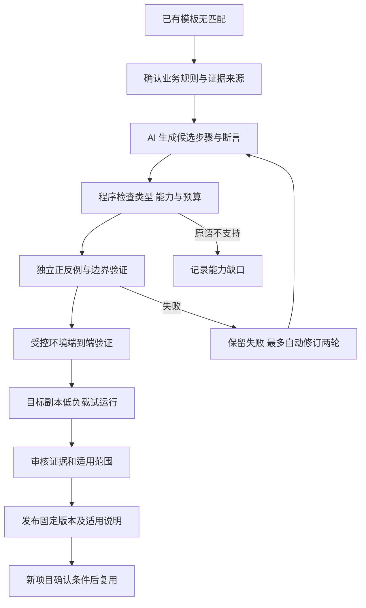

# 候选业务模板生成与验证设计

版本：1.7。日期：2026-10-12。状态：候选模板主线及压缩方案 A 已获用户接受；已统一首版验收口径，额外“未见规则”评估列为可选补强，实现精简见同步修订的计划。实施状态核对于2026-10-13：用户已授权并完成T0—T3；T3独立观察与完整HTTP对照20/20、全量回归137/137通过，标题更新仍为验证设施测试候选。真实模型生成、项目候选准入和审核发布尚未实现，继续遵守T4/T5阶段要求。

依据：[需求稿 v0.42](../../业务与容量验证系统需求与设计讨论稿.md) R08、R29、R30、R34。同步的 [实施计划 2.27](../plans/2026-10-11-website-verification.md) 覆盖 T0—T10 的生成、验证、发布、迁移与目标负载；2026-10-12 按最新蓝白四页对齐界面，本设计 v1.7 的候选语义与准入要求不变。

## 目标与边界

增加一条可审计的能力扩展链：缺少模板 → 确认业务要求 → 生成候选实验 → 验证实验本身 → 在项目副本试运行 → 发布有适用条件的模板版本 → 后续项目复用。

用户确认的是新增能力，不是允许任意代码运行、自动修改被测项目或自动认定候选正确。原有已验证模板继续直接匹配执行；候选在通过准入前与正式库隔离。按 R50 每次运行仅验证一条主流程；候选失败不阻塞该流程内条件完备的其他独立检查，不自动调度另一条流程。一条主流程仍可包含多个必要步骤和多个模板检查。按 R51，接口变化复用首次接入重新识别和确认映射，保留原规则、模板与历史证据；新映射另存并经试运行后复测，不建设专项差异分析或局部修订。

首版实施采用受约束的声明式实验定义：AI 生成 JSON 形式的步骤、取证要求和断言表达式，由仓颉校验及解释，由 TypeScript 执行注册工具。它可以产生原本不存在的步骤组合与业务断言，而不只是给旧模板换接口路径。但只能使用预先实现的操作与表达式，不能凭空产生新的底层执行能力。

备选为生成 TS/JS 脚本后在操作系统沙箱运行，表达能力更强，但需要沙箱、权限控制、依赖管理、代码审核与清理；不建议纳入这次单人首版。单纯生成自然语言测试清单开发较轻，但没有可执行、可复跑的模板积累，不满足本次目标。

## 具体例子

假设工单项目增加“修改标题”操作，用户确认：只修改标题时，优先级和所有者应保持不变。三类种子模板并没有对应实验，新候选可定义：

1. 创建一张由测试用户甲拥有、优先级为高的工单，查询并保存初始值。
2. 用甲的身份只更新标题。
3. 查询同一对象，核对标题等于新值、priority 与 ownerId 等于操作前值。
4. 若请求未被明确接受、对象关联失败、查询不完整，则给出未知，不用空值比较得出通过。

“编辑标题不改变优先级和所有者”是来自用户确认的业务要求。它不是从当前代码“恰好没有修改某个字段”推导出的正确标准。没有既存的更新操作能力时，先报告映射或原语缺口，不能让 AI 增加任意执行代码。

这是建议新增的演示性质，需要在受控样例中补一个更新操作；不代表当前网站或模板已支持。迁移时可在报名信息编辑中验证相应已确认字段保持不变，但字段与规则仍须用户重新确认。

## 候选产物与模块

| 产物或模块 | 必备内容与责任 |
| --- | --- |
| RuleContract | 规则来源、用户确认、前置条件、预期变化和禁止变化、完成时限；版本冻结后不随生成迭代修改 |
| CandidateTemplate | id/version、ruleRef、能力需求、参数、步骤、结果变量、断言、证据完整性要求、预算、不适用条件 |
| 候选生成器 | 根据规则及工具目录提出实验；不能直接设置发布状态或修改验收答案 |
| 仓颉静态检查器与解释器 | 检查类型、依赖、可达性、预算、允许操作和表达式；执行判定逻辑 |
| 验证运行器 | 提供固定观察样本及受控 HTTP 对照环境，执行正反例、边界与回归，记录失败原因 |
| ReviewRecord | 用户的业务确认、技术审核、测试结果与版本哈希；业务确认不替代技术验证 |
| TemplateRegistry | 分开保存草稿与已发布版本；变更生成新版本，记录停用与引用关系 |
| TemplateMetadata（模板内嵌） | 适用与排除条件、使用说明和验证证据；随模板审核、匹配及停用，无独立经验收录 |

这些是拟新增模块，可嵌入原核心和宿主，不要求增加独立微服务或多智能体框架。候选元数据和静态检查、状态审批应由程序控制，不能听从模型输出的“已验证”。

首版表达式只包含字段读取、存在性、相等/不等、数量、集合包含、有限布尔组合。动作仅调用已注册的登录、创建、更新、查询等项目操作；有限重复展开到明确步数。首版不开放 eval、任意 JS/SQL/shell、无界循环、安装依赖或写源文件。涉及复杂定价、小数舍入、外部异步补偿或新协议时，缺少表达能力就明确挂起，不能宣称支持任意新业务。

## 完整状态与执行过程

状态建议为 draft、needs_rule、needs_capability、validating、rejected、ready_for_review、published、disabled。模型无权从 draft 直接进入 published。

1. 缺口分类：缺映射先补映射；缺完整实验但原语足够才生成候选；缺底层原语转开发待办。
2. 规则确认：提出简短业务例子，用户确认预期值与不允许发生的变化。规则不清楚时保留草稿。
3. 候选生成：返回结构化实验，不立即在用户项目执行。按 R34，首次生成后最多自动修订 2 轮，每轮重新验证，通过即停止；仍失败保存草稿与各轮原因，不发布、不自动重新开始计数。缺原语或可信对照直接报告缺口，其他预算可提前终止。不能修改规则或放宽测试答案，只向生成器提供允许公开的诊断，不提供隐藏评估答案。目标项目存在真实业务错误不代表模板失效，不得为了消除该失败而削弱断言。
4. 静态校验：检查引用变量是否产生、查询操作能否提供断言字段、actor 与 target 是否声明、操作数及时间上限是否存在、断言是否恒真或遗漏目标规则。
5. 分层验证：按下节执行，编译通过或 JSON 格式合法只代表可解释，不代表能够检错。
6. 项目试运行：只在已确认副本和测试数据上执行，验证映射、身份与证据关联。候选在真实项目发现 fail 可以是有效发现，不要求被测项目全部通过才能发布模板。
7. 入库审核：查看规则、正反例、端到端证据、已知限制及版本。技术审核确认实验实现了规则，用户确认业务适用条件；没有足够依据则继续候选状态。
8. 后续使用：正式模板引用固定哈希；新项目重新确认规则与映射。修订必须重新通过验证，旧报告保持引用旧版本，停用后不再推荐，不生成历史影响列表；加载验证包时核对引用版本资格，已停用则提示且不直接执行。

没有人工技术审核者或可信对照材料时，不能把“模型再审核一次”当作同等替代。首版技术审核由开发者承担，普通使用者不需要编写脚本；这意味着复杂新业务未必能即时全自动入库。

## 怎样验证候选本身

### 预期答案从哪里来

规则来自用户明确要求、规格或其他经确认业务依据；标签和参考行为不能直接复制被测实现。用户可以确认“只改标题不能改变优先级”及具体例子的预期结果，但不负责证明所有代码正确。

AI 可以提出测试数据及缺陷对照草稿，不能同时作为唯一出题者、唯一答案来源和唯一验收者。新增参考环境或缺陷开关须由开发者复核，再固定版本。换一个模型做审阅只能补充检查，不能产生独立真值。

### 四层证据

| 层次 | 做什么 | 能说明什么 |
| --- | --- | --- |
| 定义检查 | 校验允许动作、字段类型、步骤依赖、预算与断言关联 | 候选可执行且符合执行限制，不能证明业务判定正确 |
| 观察样本检查 | 正确记录应 pass；priority 被重置、owner 被改应 fail；缺字段、查询失败应 inconclusive | 断言能区分指定结果，不证明真实接口能取到数据 |
| 受控端到端检查 | 独立的正确 HTTP 行为与已审核缺陷版本分别运行整条链 | 步骤、映射、采集和断言一起工作；错误必须命中对应业务断言 |
| 项目试运行与复跑 | 使用目标副本，重置测试数据后复跑，记录身份与对象关联 | 该项目该条件下能执行与取证，不证明跨项目普遍正确 |

例子的正对照应仅改变标题；负对照分别让优先级变成默认值、所有者变成他人。环境崩溃、启动失败、查询超时均不算检出这两个业务错误。测试若永远 fail，会被正对照挡住；若永远 pass，会被负对照挡住；只检查响应码，会被“返回成功但错误修改字段”的负对照挡住。

观察样本不能替代端到端对照。首版建议维护一个开发者审核过的小型 CRUD 参考服务，以及字段被重置、遗漏写入、错误对象写入等有限缺陷开关。遇到没有合适参考行为或缺陷开关的新性质，允许生成草稿，但暂停技术准入，等待补充对照。不能宣传系统可以自动制造可信的任意正确网站。

验收集中保留部分候选生成时不可见的数值、对象和正常变体；判定不得读取测试标签、项目名称或参考服务的缺陷开关。若修订反复利用同一隐藏集，需更换留出场景，不能继续称为未见评估。语义等价变更不当作真实缺陷，不能为追求“杀死变异”而改坏规则。

通过一组有限对照是有范围的验证，不能证明模板绝无缺陷；首版不承诺数学完备性，也不预填一个“正确率”。

## 可复用能力如何积累

发布的模板包含参数化步骤和判定；项目路径、账号、字段在映射中。模板内嵌说明记录适用条件与经过验证的范围，无独立经验实体。模板至少保留规则契约、生成版本、对照集版本、执行记录、审核记录与哈希。

2026-10-14交互补充：业务验证页连续完成创建、自动验证、说明编辑和双重审核；报告页保留方案及证据查看。创建候选的同一次模型请求返回独立参考说明，仅预填适用条件、排除条件和使用说明，并标注“AI参考，待确认”；参考与对应候选修订保存，不扩展可执行TemplateSpec或赋予发布权限。缺失/无效参考不否定候选，也不额外调用模型。已保存人工材料优先且可刷新/重开恢复，说明修改后重新保存和确认摘要；旧候选保留原定义和预算。

“当前项目通过验证的模板”与“已在第二项目迁移成功的模板”分开标记。只在一个网站使用过可以发布为有范围的本地能力，但不能宣称已经证明跨网站迁移。统计也分开：已有模板直接复用、候选成功验证的新能力、仍未解决的缺口。

原有冻结后的报名迁移验收不变。新增候选如果是在报名评估时才生成，计入能力扩展，不能计入原冻结模板的复用率。首版在工单开发阶段生成并验证至少一个旧模板未覆盖的新性质模板，将其与三类种子一起冻结，再在报名中仅改映射复用。之后额外使用“未见规则”测试生成能力列为可选补强，不作为首版必做、阶段放行或交付条件，也不占用材料预留时间；未开展则明确标为未验证，不外推对未见规则的生成效果。已选规则的独立正反例、端到端验证及生成时不可见的留出变体仍是准入要求；R48 最后一次小型两组对照仍保留。这些评估范围分别记录，不能混算。

模板通用资格与项目接入有效性分别检查：新项目仍须确认业务适用条件、映射、身份和证据关联并试运行；模板内容、规则依据、解释器及对照依据未变且资格有效时，仅项目映射变化不要求重复整个模板发布流程。共用执行和取证机制不允许候选绕过准入，也不允许沿用旧项目的业务结论；具体记录边界见实施计划。

## 已接受的首版压缩方案 A

用户已明确接受下表方案，替代原计划中的对应范围。未受影响的规则确认、证据、复测和材料要求继续有效。网站仍连接独立测试数据库，后移的只是验证工具直接查库取证。

| 范围 | 原计划 | 已确认首版 | 影响 |
| --- | --- | --- | --- |
| 接入与取证 | HTTP、浏览器操作、SQLite 后备取证 | 首版深度支持 HTTP/JSON，按 R31 使用测试账号密码自动登录取得 Token；网页保留结果展示，通用浏览器执行和数据库直读后移 | 减少接入范围；R01/R15 已同步修改，任务见新计划 T2/T6 |
| 容量探索 | 目标负载通过后进一步探索，超标后降载观察 | 只做目标负载与停止、结果结算；探索更高负载及降载恢复后移 | 保留目标负载结论，减少容量探索；R11/R25 已同步修改 |
| 模板适用说明 | 原独立经验收录、匹配及历史引用复核 | R49：适用说明、证据、匹配及停用并入模板；取消独立收录和历史影响列表 | 减少状态与交互，保留模板准入、版本和原始证据 |
| 网站与种子模板 | 工单、报名，三类种子模板，多种接入差异 | 保留两个小样例和三类种子模板，只覆盖一个主流程及必要测试账号 | 控制场景规模，不取消迁移或既有三类检查 |
| 新模板表达范围 | 新增方向尚未细化 | 先支持字段关系、数量、有限顺序与布尔断言；演示一个旧模板没有的新性质 | 不能覆盖复杂定价、任意状态机和新协议；仍可验证真实的能力增长 |
| 交付与评估 | Markdown、验证包、材料、最后的两组对照 | R48：对照仅一个代表性业务，两组各一次完整流程，不做多轮统计；第三方项目可选 | 保留核心准入与复用验证，不挤占材料时间，不把对照提前 |

最不能压缩的是规则确认、正反例、端到端证据、版本和适用边界；压缩这些会让 B 退化为未经验证地执行 AI 生成测试。

新增工作至少包含：受约束实验语言与解释、候选状态机、对照运行器及准入、版本入库。现有项目还没有实现，不能可靠估算“增加几天即可完成”。应先做一个候选从生成到检错再复用的技术验证，再重排日期；若技术验证失败，应缩小表达范围或调整首版目标，不能降低验证门槛冒充完成。

## 首个技术验证闭环

给生成器一个没有对应现成模板的“只改标题，优先级与所有者保持不变”要求。生成器产出声明式候选；正确服务通过，两种缺陷服务因对应断言失败，查询失败为未知；经过审核发布，再在第二网站只改变映射运行。随后故意修订错误断言，确认准入阻止其覆盖已发布版本。

验收产物是候选定义、冻结规则、正反例和端到端记录、审核状态、正式版本与第二项目的复用记录。模型说“我已生成并验证”不是产物。该闭环安排于修订计划 T3—T7；所有实现与运行仍未开始。

## 参考依据

- [Anthropic Agent evals](https://www.anthropic.com/engineering/demystifying-evals-for-ai-agents)：区分运行轨迹与最终环境状态，组合程序和人工评价并维护回归集。本文具体准入流程是本项目设计，不是来源对本项目效果的验证。
- [Stryker 变异状态与指标](https://stryker-mutator.io/docs/mutation-testing-elements/mutant-states-and-metrics/)：检错评估须区分测试结果和编译/运行异常等状态。本文采用有限的已审核缺陷对照，不承诺引入完整通用变异平台。
