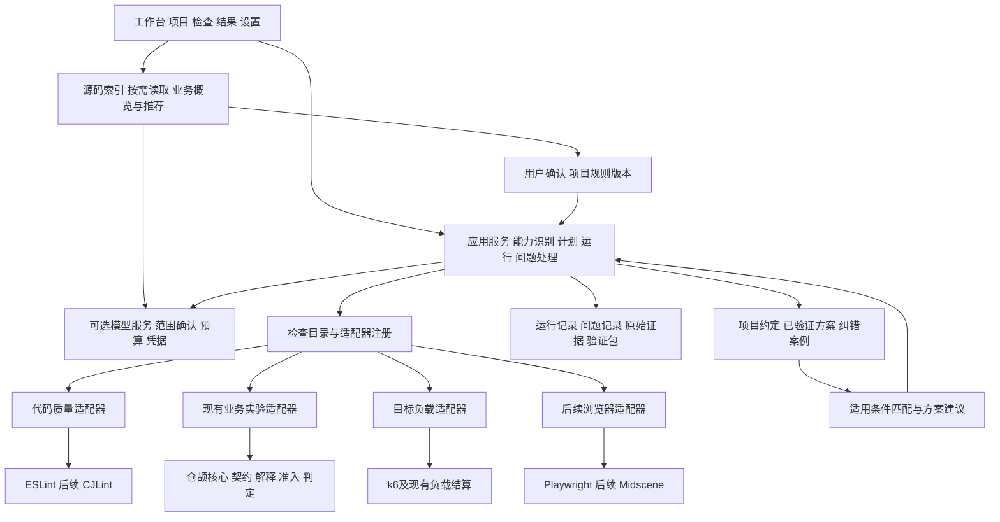

# AI 开发网站验证系统架构与用户流程设计

日期：2026-10-14  
状态核对：2026-10-17，源码分析与受控执行的S1—S5开发链已接入main@ceb8d95。本文仍是目标架构；代码质量适配器、独立纠错案例及经验扩展不据此视为已实现。当前操作以[编号流程](../../WORKFLOW_V12.md)为准，实际验证见[证据索引](../../evidence/README.md)。
原设计授权（2026-10-14）仅涵盖架构与流程梳理，后续已开发范围以分阶段计划和证据为准；本轮只整理文档，不扩展开发或安装范围。提交和推送按用户另行授权执行，不等于正式发布。

主线：导入源码 → 授权范围内分析业务 → 推荐项目特有检查 → 确认预期并保存项目规则 → 判断执行能力 → 验证方案并执行 → 证据与复测。细节见[源码业务分析专项设计](2026-10-14-code-grounded-business-discovery.md)，阶段入口见[新增实施计划](../plans/2026-10-14-code-grounded-business-discovery.md)。命名审查和独立经验能力为后续扩展。

本项目面向懂一些开发、缺少系统测试经验的个人开发者，帮助他们判断 AI 辅助开发的网站有哪些问题、结论依据是什么，以及修复后是否得到验证。建议采用本地模块化单体：保留仓颉业务验证核心，在宿主增加统一检查协调与结果协议，让代码质量、业务验证和目标负载各自执行、共同形成可复查证据。经验由项目约定、已验证方案和纠错案例组成，服务下一次检查。

本文描述已确认的目标方向，不表示当前产品已具备新增能力。[需求稿v0.44](../../业务与容量验证系统需求与设计讨论稿.md)R53—R60定义新增范围；[候选机制](2026-10-11-candidate-template-lifecycle.md)的可信准入约束继续保留，[既有实施计划](../plans/2026-10-11-website-verification.md)记录历史证据与未完成验收。新增计划不关闭旧验收。

## 1 产品边界与总体选择

用户持续围绕一个项目完成：选择检查 → 取得证据 → 处理问题 → 修复后复测 → 复用已验证做法。AI承担规则澄清、候选生成、语义审查和解释；明确的命名规则、测试执行与阈值判断交给确定性工具及既有验证核心。

| 路线 | 代价与结果 | 选择 |
| --- | --- | --- |
| 沿现有 HTTP 流程追加全部检查 | 改动起步快，但静态检查仍依赖账号、环境、业务模板 | 不推荐 |
| 保留核心，抽出能力识别、检查适配器和统一证据 | 可逐项迁移，旧业务实验作为一种检查接入 | 推荐 |
| 重建通用多 Agent 开发平台 | 定位、运行时、权限、数据及界面都要扩大，当前需求不足以支撑 | 暂不采用 |

继续本机 Windows 工作台、一名使用者、本地项目与证据存储。新增阶段优先分析JS/TS及TSX/JSX源码，形成业务概览与项目规则；源码分析无需启动网站。概览允许多条业务，每次正式运行只针对一条主流程的若干检查。命名及其他语言检查器、独立经验库、浏览器检查均后移；目标负载保留为业务验证通过后的独立后续运行。

## 2 现有架构与需要拆开的边界

现有 React 工作台通过本机 HTTP API 调用 TypeScript 宿主。宿主负责项目副本、启动及认证、模型、模板注册、执行与存储；通过 JSONL 子进程协议连接仓颉核心。仓颉包含契约、解释器、调度、准入、模板资格、判定及负载相关逻辑。k6由宿主接入。该物理部署结构可以保留。

当前限制来自业务抽象：

- `projects/inspect.ts` 在一次识别中要求 HTTP 映射、账号、测试初始化及特定 Node/Express 条件，不能单独表达“源码能审查，但网站不能运行”。文件收集还限制扩展名，未来需显式覆盖 TSX/JSX、仓颉等检查目标。
- `contracts/types.ts` 的映射、观察、断言偏向业务执行，缺文件位置、诊断类别、规则来源等代码审查语义。
- `api.ts` 集中项目状态、凭据、候选、审核、运行，规则目录固定；`workflow.ts` 的流程与规则选择也带有当前业务预设。
- `replay.ts` 和 `load/runner.ts` 有各自运行记录；验证包目前只封装既有业务运行，不能直接宣称支持任意检查复跑。
- 模板已有适用条件、排除条件、说明、版本和证据，但还没有独立的纠错案例与问题处理记录。

拆分时按责任逐步迁移，不要求重建所有文件或替换现有持久化。

## 3 目标模块及责任

| 模块 | 负责 | 边界 |
| --- | --- | --- |
| 源码分析服务 | 建索引、按业务链读代码、保存来源和覆盖、生成检查建议 | 与启动/初始化解耦，事实、推断与预期分开；不执行源码里的指令 |
| 项目规则服务 | 保存用户确认的新规则及版本，按项目隔离 | 与全局已发布模板分开；新规则不自动拥有执行和验证资格 |
| 工作台 | 显示当前项目、能力缺口、下一步、证据及复测入口 | 不在前端决定模板资格或推断检查通过 |
| 项目能力服务 | 源码清单及指纹、工具可用性、运行配置、测试环境条件 | 读取项目不等于执行项目；保留运行检查的原有保护 |
| 检查目录 | 列出检查名称、类别、需要的能力、配置及适配器版本 | 以实际可用项展示，不用固定业务规则数组充当全部目录 |
| 计划与运行服务 | 冻结本轮范围、依赖和版本，协调执行、取消及恢复状态 | 初期顺序执行即可；不实现通用工作流编辑器 |
| 检查适配器 | 调用一种具体检查能力，保留原始输出并转换结果 | 不自行修改确认过的规则，不改写历史报告 |
| 仓颉核心 | 继续承担现有业务解释、判定、准入与资格逻辑 | 不强迫静态诊断携带账号身份或查询完整性字段 |
| 证据与问题服务 | 保存事实、关联处理记录、比较复测结果及导出 | 原始运行不可变；人工意见作为追加记录 |
| 经验服务 | 匹配项目约定、方案和经确认案例 | 相似历史仅提供建议，不能替当前项目判定 |

整体计划由宿主协调，业务步骤仍由既有仓颉调度器管理，避免两个层级同时推进同一组业务步骤。仓颉继续拥有其现有判定权；外部检查器诊断由适配器保留来源与版本，不伪装成仓颉业务判定。

## 4 用户看到的页面和完整流程

保留四个主要页面，将“业务验证”扩为“检查工作台”，“验证报告”扩为“结果与复测”。模型设置保持支线。经验入口放在项目约定、方案详情及问题详情中；暂不增加独立经验管理后台。

| 页面 | 用户要完成的事 | 主要内容 |
| --- | --- | --- |
| 项目 | 选择网站源码，了解现在能检查什么 | 项目摘要、能力状态、约定、历史任务入口 |
| 检查工作台 | 选检查并补齐这次需要的条件 | 代码质量、业务检查、方案状态、本轮计划及运行进度 |
| 结果与复测 | 理解问题、取得证据、修复后重新检查 | 分类结论、问题详情、运行历史、复测比较、业务负载入口 |
| 设置 | 配置可选模型与查看本机工具状态 | 模型连接、凭据、检查器可用性；返回原任务 |

### 4.1 第一次接入

1. 用户选择本机项目目录，本地建立允许范围内的源码索引与快照指纹；不启动网站、不自动发送代码。
2. 分别显示源码分析与业务运行条件，例如“源码可分析；测试初始化缺失”。verification.json不是分析前提。
3. 用户确认目录摘要、源码范围和模型后，AI按入口→服务→数据→权限关系补读片段，展示有引用的业务概览和未覆盖范围。已有方案仍可直接选择，不强制重新分析。

现有业务接入限制移到业务能力判定中继续生效。静态检查绕开不相关的运行条件，但不绕开路径、文件范围和检查器执行约束。

### 4.2 选择检查

业务区展示源码中发现的业务及推荐检查，用户选择一条深入并确认关键预期。新规则保存到项目规则库；固定规则只作为种子，不限定推荐范围。每项显示“已有方案可用”“可生成新方案”“待补条件”或“待扩展能力”，并展示代码依据。代码质量分类后续接入后才显示可用项。

选择后形成任务草稿：本次查哪些文件、哪一条业务流程、采用哪些规则和方案。用户可运行条件齐全的子集，但必须明确确认实际范围；其他已选项保持待办，不能静默取消，也不让整个任务显示全通过。

### 4.3 补齐本轮条件

| 检查类型 | 用户需要补齐的条件 | 不要求的条件 |
| --- | --- | --- |
| 确定性命名检查 | 目标文件、规则配置及可用检查器 | 网站启动、测试账号、模型密钥、业务模板双审核 |
| AI语义审查 | 所选代码范围、审查约定、模型及发送范围确认 | 网站启动；输出保持建议或待核实发现 |
| 业务验证 | 测试副本、账号及数据、映射、已确认业务规则、合格方案 | 有合格方案时无需重新生成或配置模型 |
| 目标负载 | 当前条件下合格业务运行、目标负载及评价标准、执行确认 | 不需要静态命名问题全部清零 |

业务缺方案时仍走“生成候选 → 独立验证 → 项目试运行 → 人工审核 → 保存可复用方案”。这条复杂支线仅在需要新业务方案时出现。普通命名规则配置通过规则摘要确认生效，不能套用业务模板发布流程。

模型配置成功后返回原任务；不自动发送代码或启动检查。未使用AI的任务不要求Key。

### 4.4 执行与中断

开始前展示检查范围、工具及规则版本、涉及的测试环境、AI发送范围和缺项。确认后冻结计划，后台执行并持续写入进度与证据。相同启动请求用请求标识去重。

静态检查可以独立完成；业务环境失败只阻断依赖它的检查。点击停止后展示已完成项和未覆盖范围，业务与负载继续使用各自现有停止及结算规则。

刷新恢复草稿和进度；宿主重启后将未完成执行标为中断。恢复任务上下文不等于自动重放有副作用的操作。用户重新运行时创建新运行记录，关联原任务并重新检查条件。

### 4.5 查看结果与处理

报告首先回答：发现什么、哪些检查未完成、这些结论覆盖什么。代码规范、业务正确性、负载表现分别展示，不合成一个容易掩盖问题的总分。

每条发现展示规则、预期与实际、位置或业务步骤、证据、影响范围及下一步。代码位置缺失时明确无法精确定位，不能生成虚构行号。AI提供的修复解释与检查器原始诊断分开显示。

用户可复制问题说明交给自己的开发工具、标记已尝试修复、记录不适用理由或发起复测。“已尝试修复”和“人工忽略”都不改写原运行结论。首期不内置自动改代码和提交。

### 4.6 修复后复测

1. 重新识别源码，说明变化及需要重新确认的条件。
2. 默认沿用原规则与工具版本，选择受影响检查；原版本不可用时标为不可严格比较，不能偷偷升级。
3. 新运行保存独立证据，并引用原运行。
4. 对覆盖范围内的问题显示“本次未再检出”“仍存在”“新增”；被排除、检查失败或未运行的项显示“未复核”。

代码行号移动时采用规则、文件和代码上下文等信息辅助匹配；匹配不确定时展示待核对，不按行号变化直接宣布修复。规则变更或新增豁免造成的消失应标为“规则或范围变化”，不能算作修复成功。

### 4.7 目标负载与历史复跑

目标负载继续从业务报告进入，独立创建运行并绑定来源业务运行、源码、映射和规则版本。源码或环境改变后重新业务验证；代码规范通过不能解除业务前置条件。保留记录表现与判断达标两种模式及同机测量边界。

历史报告默认只读。复跑验证包时检查对应适配器、工具和规则版本及本机所需材料；缺失时允许查看历史但阻止执行并列出缺项。复跑包不承诺包含网站环境、凭据或全部工具。

## 5 核心对象与扩展接口

以下是设计契约，不是已实现API。先稳定概念，再在实施计划中确定端点与文件拆分。

| 对象 | 最小内容 | 意义 |
| --- | --- | --- |
| 项目快照 ProjectSnapshot | 项目ID、文件清单及内容摘要、语言、配置摘要 | 说明检查的是哪个版本与范围 |
| 能力 Capability | 名称、可用/受阻/未知、原因、依赖及核对指纹 | 一个能力缺失不阻断无关检查 |
| 检查定义 CheckDefinition | 检查ID与类别、适配器版本、配置约束、所需能力、规则来源 | 新检查可以注册，不必修改所有业务分支 |
| 检查计划 CheckPlan | 已选检查、目标范围、项目快照、规则及配置版本、依赖、确认信息 | 冻结用户实际同意执行的内容 |
| 运行 CheckRun | 计划引用、状态、时间、覆盖情况、子检查结果及父运行 | 区分任务草稿、一次执行及复测 |
| 发现 Finding | 检查与规则引用、类别、严重程度、来源、说明、位置或业务步骤、证据引用、匹配指纹 | 统一定位问题，同时保留具体检查的语义 |
| 证据 Evidence | 原始产物引用、摘要、产生工具及版本、运行和来源 | 报告可回查，保留原生输出格式 |
| 处理记录 Disposition | 发现引用、用户判断、理由、时间、关联复测 | 与原始事实分离，支持误报和豁免 |
| 经验条目 KnowledgeEntry | 类型、作用域、条件、来源、状态、版本及验证记录 | 区分项目约定、方案和纠错案例 |

检查适配器提供五项能力：描述自身与配置、检查前置条件、生成计划摘要、执行并产出标准结果、取消及收尾。复测使用同一执行入口和冻结配置，另加原运行引用；避免实现一套不同语义的“快速复测”。

统一结果只统一外层。内部载荷按代码诊断、业务断言、负载指标等类别区分，并保持各自字段验证。沿用现有业务 Observation 和 Verdict 作为业务载荷，不用大量可空字段扩成“万能观察对象”。必要时增加SARIF导入/导出转换，业务证据无需迁就静态分析格式。

执行状态与结论分开：

- 执行状态：排队、准备、运行、完成、受阻、中断、取消、工具错误。
- 结论：通过、发现问题、证据不足、仅观察、不适用。
- AI建议另带“待核实”标记；置信分数不能替代证据等级。

只有检查完成、覆盖满足计划且证据有效时才产生“本轮所选范围通过”。任务可以“已结束但部分受阻”；必须展示分项覆盖，不把进程退出码直接当业务结论。

## 6 代码质量审查的具体接入

### 6.1 首个适配器

本节保留为后续扩展设计，不属于当前新增阶段。源码业务主线完成后，可接入 TypeScript 命名检查：读取确认的规则配置 → 对指定源码快照运行 ESLint/typescript-eslint → 保留JSON输出、配置摘要及工具版本 → 转换为 Finding → 进入结果工作台的新分类 → 支持原配置复测。

配置优先采用项目已有且用户确认的约定；没有约定时展示简单推荐配置再确认。区分函数/变量、类型/类、React组件及外部字段，避免统一强制所有标识符使用同一种大小写。生成代码、第三方代码和外部协议字段的排除范围必须明确记录。

静态检查无需业务初始化，但会执行检查器及其插件。初期使用应用已核对的检查器与声明式规则配置，不自动执行导入仓库中的任意脚本或未核对的可执行ESLint配置；无法兼容时说明缺口。检查过程中不自动修复目标源码。

### 6.2 两种审查结果

| 类型 | 示例 | 输出与责任 |
| --- | --- | --- |
| 确定性规范 | 类型PascalCase、函数camelCase、禁止特定前缀 | 检查器直接给出规则、位置和诊断 |
| 语义与设计建议 | 函数名是否误导、模块责任是否混杂 | AI结合局部代码与项目约定给出理由及引用，待核实；需要时转成可执行规则或回归检查 |

后续CJLint通过同一适配器契约接入，不要求迁移整个运行核心。每种语言单独核对文件收集、版本、输出格式及Windows可用性。现有源码收集扩展名前置限制须按能力扩展，并保证源码指纹覆盖实际被检查的文件。

## 7 经验沉淀的具体接入

当前新增阶段只保存分析来源、用户纠正和项目规则，用于本项目复用（R59）。以下独立纠错案例、跨项目推广及经验推荐仍为后续提案，不能因本次主线确认自动纳入开发范围；R49模板说明合并机制保持。

### 7.1 三类信息分别保存

| 类型 | 例子 | 使用方式 |
| --- | --- | --- |
| 项目约定 | API DTO保留外部字段命名，内部变量用camelCase | 在本项目选择或配置检查时使用；变化后生成新规则版本 |
| 已验证方案 | 一套重复提交业务实验及适用、排除条件 | 继续使用现有模板审核、匹配、版本与停用机制 |
| 纠错案例 | 某诊断是外部字段误报，修订排除范围后正反例均符合预期 | 下次推荐核对点或规则修订，不直接覆盖当前诊断 |

### 7.2 从结果到案例

用户在问题详情中记录纠正原因或修复说明。系统只保存处理记录；当关联复测完成时，提供“保存为项目案例”。可预填现象、原因、处理方式、适用与排除条件、原发现、规则版本及前后证据，由用户核对保存。

尚未复测也可保留“未验证记录”，但不进入已验证经验推荐。案例状态为草稿、项目内有效、停用；跨项目推广另行审核适用范围和正反例，不因一次成功自动变成通用规则。

首期入口只放问题详情及项目约定，避免新增一套收录向导。经验保存是可选后续动作，不阻断用户查看结果或继续检查。

### 7.3 如何影响下一次检查

按项目作用域、语言、框架、规则ID、错误类别和版本条件筛选，再用关键词检索补充。显示“为何推荐、适用条件、来自哪次验证”。先用本地结构化存储；规模和检索效果确实需要时再评估全文或向量检索。

项目事实默认不跨项目生效。停用或条件不符的案例不推荐，历史证据保留。人工忽略只影响当前处理视图；若要成为后续规则豁免，用户必须明确范围并形成版本化配置。AI总结只引用允许的资料，遇到无证据原因应保留未知。

### 7.4 与现行 R49 的关系

模板说明继续并入模板，不恢复独立模板经验收录流程。新增“项目约定与纠错案例”是超出现行R49首版范围的扩展提案；审定本文后需要明确修订R20/R21/R49相关边界。不会把本次梳理解释为已批准开发或已批准整个独立经验平台。

## 8 现有部分保留与调整清单

| 现有部分 | 处理 | 具体变化 |
| --- | --- | --- |
| `apps/core` 仓颉核心及JSONL通信 | 保留 | 继续解释和判定业务实验，保留准入、资格及现有负载逻辑；外层桥接新结果 |
| `execution` HTTP、认证和映射 | 保留并封装 | 归业务适配器使用，不作为所有检查必需条件 |
| `projects/copy`、启动、复位及owned runner | 保留 | 继续为业务与负载提供测试副本；代码审查使用只读范围 |
| `projects/inspect.ts` | 拆分职责 | 基础源码识别与业务运行能力分开，补按检查类型的文件范围 |
| `api.ts` | 逐步调整 | 路由调用项目、计划、运行、经验等应用服务；注册目录替代扩展时不断追加固定分支 |
| `packages/contracts` | 增量扩展 | 增加检查外层对象与分类载荷；保留旧业务协议，不原地破坏v1 |
| `replay.ts` | 保留业务执行，增加桥接 | 业务运行成为统一任务的子检查；复测继续校验原版本与条件 |
| `templates/store.ts` | 保留 | 继续业务方案发布与匹配；不承担任意静态检查配置或所有经验数据 |
| `model`、凭据、预算与发送确认 | 保留并复用 | 候选生成与未来语义审查共享基础服务，分别记录用途和范围 |
| `load`、k6及结算 | 保留并封装 | 保留业务前置条件，以统一运行引用关联负载结果 |
| `artifacts`、报告和验证包 | 保留并版本化扩展 | 新检查可保存原生证据，旧包可读；新格式说明工具依赖和复跑条件 |
| 四页UI与草稿/冲突/会话恢复 | 保留机制，调整组织 | 检查类别按需显示条件，报告统一问题入口，已有草稿兼容读取 |
| 现有样例、独立正反例及留出验证 | 保留 | 继续保护业务可信链，新适配器追加有意义的验收场景 |
| 项目约定、问题处理及纠错案例 | 新增 | 与历史运行分开存储，以引用关联 |

旧运行记录与模板版本不批量改写。读取旧数据时通过兼容层映射为业务检查视图；新任务使用新schema。旧包仍走原解析与资格校验，新包缺适配器时可查看不可执行。没有版本兼容和回读证据前，不迁移或清理现有正式数据。

## 9 实施顺序及完成标准

这是一组依赖顺序，尚未授权实施。

| 阶段 | 工作 | 能证明完成的结果 |
| --- | --- | --- |
| S1 源码基础 | 独立源码快照、索引、来源定位与读取范围 | 无verification.json、网站不能启动也能索引；旧业务接入保护保留 |
| S2 业务发现 | 受控多轮读取、业务概览、推荐及覆盖说明 | 推荐有真实源码依据，引用和源码版本可核对，预算中断不报完整 |
| S3 项目规则 | 用户确认、版本化新规则、能力分级和工作台 | 新建议进入项目规则，不再导回固定列表；缺口清晰 |
| S4 新业务闭环 | 新规则映射、候选独立验证、实际执行与复测 | 一条种子规则外的新性质通过正反例及证据不足验证，保留真实运行证据 |
| S5 复用与交付衔接 | 变化失效、纠正记录、历史兼容及旧流程回归 | 旧包可读、过期结论不沿用、旧负载和交付责任保留 |

架构验证优先选无运行配置但可分析源码、实现与业务预期冲突、种子规则外的新检查，以及源码变化导致旧分析和负载资格失效。命名、独立经验与浏览器检查不并入当前五阶段。

既有T9实际审核、业务/负载、导出重开、交付及T10等开放事项按原证据处理，不因架构说明完成而关闭；如果开发顺序调整，需要在下一版计划中明确承接。

## 10 审阅要点

产品方向已确认：从源码发现业务与项目特有检查，再进入可信验证链。本次同步模块边界和五阶段顺序；具体任务、验收和阶段停止点见新增实施计划。独立经验平台和命名审查仍是后续范围。

审阅通过只进入文档同步与实施计划准备；编码仍需明确授权。

## 11 依据与参考

- 当前实现：`apps/core/src`、`apps/host/src/projects/inspect.ts`、`api.ts`、`replay.ts`、`templates/store.ts`、`manifest.ts`、`load/runner.ts`、`packages/contracts/types.ts`及四页UI。
- 当前流程：[编号流程与操作保护](../../WORKFLOW_V12.md)；原自然流程设计已合并，历史原文见[文件迁移索引](../../evidence/README.md)。
- [reviewdog](https://github.com/reviewdog/reviewdog)及[诊断协议](https://github.com/reviewdog/reviewdog/blob/master/proto/rdf/reviewdog.proto)：参考检查输出与展示解耦。
- [typescript-eslint 命名规则](https://typescript-eslint.io/rules/naming-convention/)及[CJLint文档](https://docs.cangjie-lang.cn/docs/1.0.0/tools/source_zh_cn/tools/cjlint_manual.html)：候选检查器，具体版本与本机兼容性在接入阶段验证。
- [Schemathesis](https://github.com/schemathesis/schemathesis)、[Midscene](https://github.com/web-infra-dev/midscene)：API及界面执行能力候选。
- [LangGraph持久化](https://docs.langchain.com/oss/javascript/langgraph/persistence)：参考任务检查点与长期知识分离，未决定引入框架。
- [CodeLin案例](https://bbs.huaweicloud.com/blogs/474082)与[AgentMem](https://github.com/louloulin/AgentMem)：记忆服务分层参考；不直接采用完整平台，不据公开宣传指标作效果承诺。
