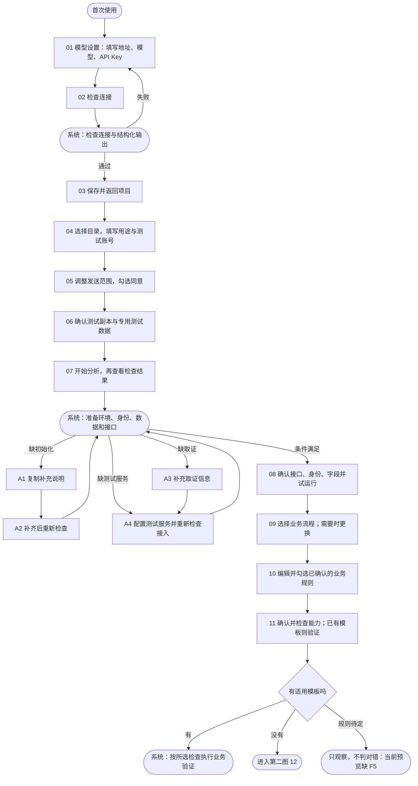
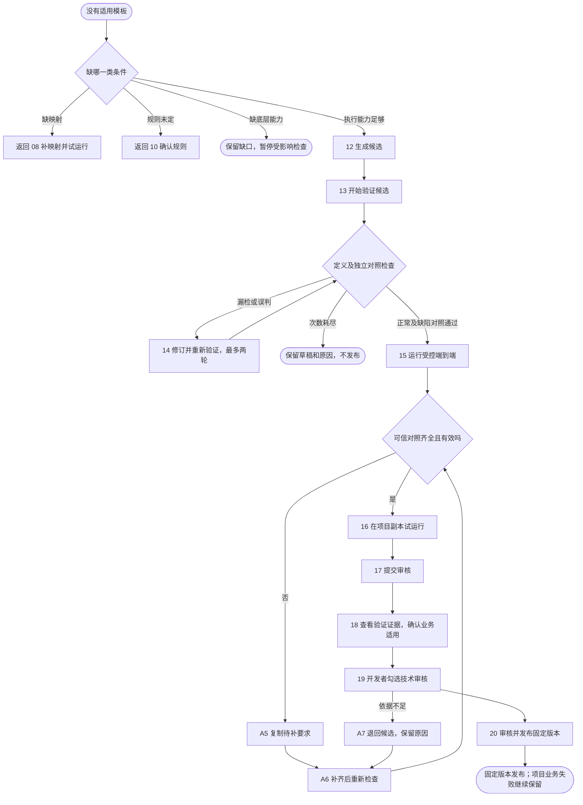
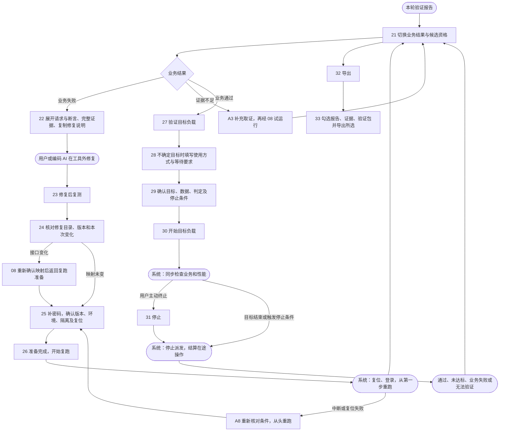
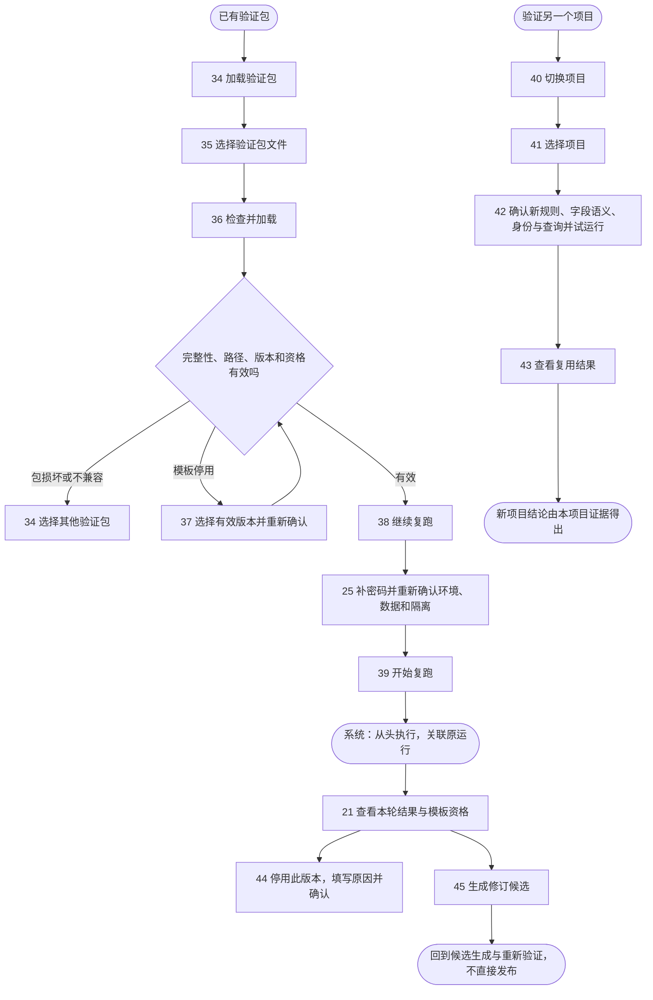

# 用户点击流程图与当前预览缺陷

2026-10-12。本轮只说明、编号和审查，未修改四页源文件。蓝色数字表示用户操作；圆角“系统”节点表示自动处理，不是要求用户再点一次。A1—A8 是异常恢复分支。输入、可选折叠详情与必要确认归在相邻操作步骤内。

## 一、模型与项目接入

本轮复现：02→03 默认预览无法自动继续，属 F1；04→05 调整范围会重置无关表单，属 F2。A1—A4 为当前源文件中的异常入口，本轮未对每种实际接入条件进行识别或真实检查。

## 二、无模板候选到审核发布

18 与 19 缺一项，20 均不可发布，本轮重新点击核对。15—16 的验证结果是固定示例，不是实际参考服务执行。本轮未逐一重测缺原语、次数耗尽、模型中断及预算耗尽的恢复执行。

## 三、报告、修复复跑和目标负载

自动处理在真实产品中不应需要“显示结果”按钮。当前默认预览没有自动推进，26 后停在运行中；30 后的完成/结算同样只在检查模式手动演示，属 F1。工单提交业务通过后没有 27 的完整入口及绑定，属 F4。导出选择只是预览，不生成真实文件。

## 四、验证包复跑、跨项目复用及模板维护

F3：44 停用 v1.0 后，37—39 使用有效 v1.1，摘要显示已发布 v1.1，资格卡却显示 v1.1 已停用；40—43 又允许已停用 v1.0 被标为有效并得到迁移通过结果。停用状态没有按模板版本和入口统一处理。

F6：目前包内容、证据和迁移主要固定字段保持；保存结果、重复提交、权限隔离没有各自完整成果与迁移表达。不能将图中通用路径视为所有模板都已覆盖。

## 缺陷清单

| 编号 | 关联点击 | 本轮证据 | 建议优先级 |
| --- | --- | --- | --- |
| F1 | 02→03、26、30、39 | 默认模型检查、普通复跑停在处理中；完成和结算仅检查模式可模拟，默认不能自助点通整条链。 | 高：保留最终文案，同时给静态预览明确的模拟推进方式 |
| F2 | 04→05 | 修改目录及用途、勾选环境后调整发送范围，目录/用途恢复默认，环境确认丢失。 | 高：只撤销范围同意，保留无关输入 |
| F3 | 44→37→39→21；40—43 | v1.1 摘要“已发布”与资格卡“已停用”冲突；停用 v1.0 仍被新项目推荐/试运行。 | 高：按模板与版本核对资格，所有入口共用 |
| F4 | 27—30 | 工单提交的修复后通过结果无负载入口，负载仍固定编辑工单/字段保持。 | 中：绑定主流程和所选检查 |
| F5 | 10→11→21 | 未确认项只被排除，没有“只观察未判定”的具体结果记录。 | 中：区分未执行、待定观察与无法验证 |
| F6 | 22、32—43 | 种子检查的完整证据、包及跨项目映射主要未展开，当前仍是字段保持样例。 | 中：按对应业务展示成果与迁移 |

F1—F3 是本轮新增复现，F4—F6 为上一轮缺口的本轮再次核对。本轮不修复上述问题、不开发实际功能。截图布局未见明显遮挡或重叠；复跑准备页较长，确认及开始按钮需向下滚动。截图本身不能证明完整键盘、读屏或真实运行能力，未作此类验收结论。

## 证据说明

本轮 20 张新截图，URL、可见 DOM 和按钮位置保存在 `screens.json`；缺陷保存在 `findings.json`。截图上的序号由实际按钮位置叠加在独立说明页，不修改产品界面或原图。部分序号是同一操作阶段的输入、勾选和确认，全部按钮对照见 [编号点击说明](编号点击说明.html)。

为检查后续状态，02 的断点后使用明确的状态链接；替代包结果使用 `inspect=1` 的固定模拟。并非默认界面从 01 自助连通到了 45。演示使用的密码与密钥均为 preview-only；没有读取真实项目、请求模型、发布模板、实际加载包或执行负载。来源哈希的本轮前后对比见 `source-verification.json`。
